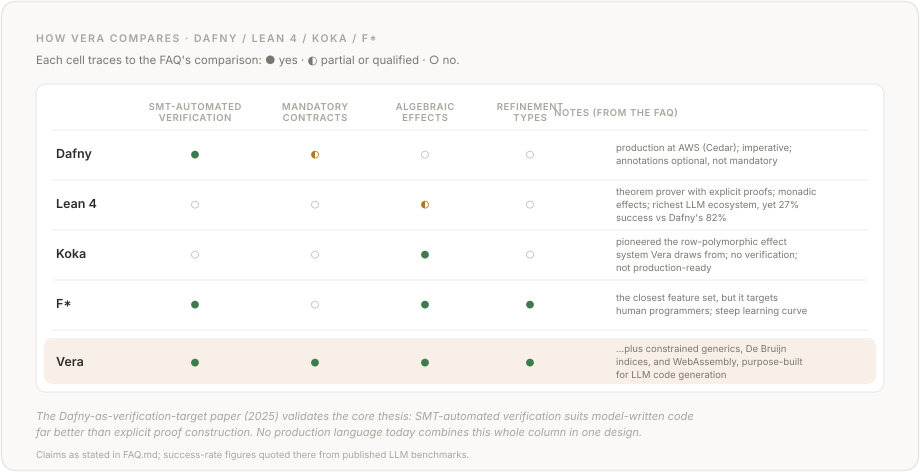

# Frequently Asked Questions

## Why no variable names?

Variable names are one of the things that confuse LLMs rather than help them. Unlike with humans, names undermine a model's efforts to keep track of state over larger scales. Models confuse similarly named variables in different parts of the codebase easily. Names help us; they do not help them.

Wang et al. ("How Does Naming Affect LLMs on Code Analysis Tasks?", [arXiv:2307.12488](https://arxiv.org/abs/2307.12488)) systematically replaced variable and function names with nonsense or shuffled strings and measured the impact on CodeBERT across code analysis tasks. Good names do help LLM performance, but shuffled names (where a variable named `count` gets swapped with one named `result`) perform *worse* than random gibberish. Plausible but wrong names mislead the model. Python, being dynamically typed, is hit harder than Java, because models compensate for lost names using type declarations in statically typed languages.

That last point is the Vera thesis in miniature. In a language with strong types, explicit contracts, and no variable names, the model cannot fall back on the naming crutch, but it also cannot be misled by it. It has to use the structural information.

Le et al. ("When Names Disappear", [arXiv:2510.03178](https://arxiv.org/abs/2510.03178)) make this sharper still: LLMs exploit statistical correlations between identifiers and functionality even on execution prediction tasks that should depend only on program structure. They call this "identifier leakage." The model *appears* to understand code when it is pattern-matching on familiar tokens.

So the problem is not that variable names are useless to LLMs; it is that they are a crutch that lets the model appear to understand code it is not reasoning about. Vera's bet is that if you remove the crutch and give the model verified structural information instead (contracts, types, effect declarations), you force it onto firmer ground.

See [`DE_BRUIJN.md`](DE_BRUIJN.md) for a deeper treatment: where the indexing idea comes from academically, how Vera's typed variant differs from classic De Bruijn indices, worked examples of the common traps (particularly the commutative-operations pitfall), and further reading.


## Why not keep variable names and strip them with tooling?

You could build a bidirectional transform: names in, indices out for the model, indices back to names for humans. The tooling for that would be straightforward.

Vera does not do this because the canonical form *is* the language. If names exist in the source, they are part of the program, which means they can diverge from intent, be inconsistent, or be misleading, and there are then two representations to keep in sync. Vera has one representation, unambiguous by construction, and the model writes exactly what the compiler sees, with no translation layer to keep in step.

A visualiser that infers human-readable names from types and usage for display would be tooling *on top* of Vera. The canonical form stays clean for the model, but humans get an annotated view when they need one.


## But don't variable names help the LLM relate implementation to requirements?

This is a fair point. The contracts can say what the output *cannot* be, but if the constraints fully determine the output then the function body is superfluous. So the implementation matters, and should it not be tied to the human's requirements?

Vera's answer is that the contracts *are* the link between implementation and requirements. The human writes (or reviews) the contracts (preconditions, postconditions, effect declarations), and those are small, declarative, and human-readable. The compiler then proves the implementation satisfies them. The human audits the specification, not the code.

The bet is that contracts are a better surface for capturing intent than variable names scattered through an implementation. A function signature with `requires(@Int.1 > 0)` and `ensures(@Int.result == @Int.0 / @Int.1)` communicates what the function does more precisely than any variable name could.


## How do type aliases interact with `@T.n` references?

A slot reference names a type, so `type` declarations are how a program shapes its own slot namespaces. Three rules apply, and they differ.

At the **head** of a slot name an alias is opaque. `type Cnt = Int;` does not make `@Cnt` and `@Int` interchangeable; a parameter declared `@Cnt` is reached only by `@Cnt.0`. That opacity is what stops a library adding an alias and silently splitting a caller's `Int` stack.

Inside a type **argument** an alias resolves. Under the same declaration, a parameter written `@Option<Cnt>` binds `Option<Int>` and is referenced `@Option<Int>.0`, because `Option<Cnt>` and `Option<Int>` are one type, and one type must not become two namespaces.

A `State<T>` or `Exn<E>` **cell** resolves through the head as well: identity is the *resolved* type, so a helper declaring `State<Option<Int>>` and a handler spelling `State<MaybeInt>` share their state. That holds wherever the resolved type has a mangle-safe family name; see [`DE_BRUIJN.md`](DE_BRUIJN.md) §6.5 for the one case where the compiler falls back to the spelling instead.

The practical consequence is that an alias is how you give a parameter a name without reintroducing names. Two parameters of one underlying type become two stacks, so every reference is `.0` and there is no ordering to get wrong:

```vera
type Meters = Int;
type Feet = Int;

private fn excess(@Meters, @Feet -> @Int)
  requires(true)
  ensures(true)
  effects(pure)
{
  @Meters.0 - @Feet.0 / 3
}
```

`vera check --explain-slots` prints what each parameter actually bound, and spec [§3.8 and §3.8.1](spec/03-slot-references.md) are the formal statement.


## What actually gets verified?

There are three layers, and they cover different things.


**Layer 1: Type system (mechanical).** Every binding uses typed De Bruijn indices (`@Int.0`, `@String.1`, etc.), so the type checker can verify that every reference resolves to a binding of the correct type, every function call matches its signature, every pattern match is exhaustive, and generics monomorphise correctly. This is the "components slot together" layer. Nothing novel here beyond the index scheme; the known gaps in it, such as a case missing inside a nested constructor pattern, are listed in [KNOWN_ISSUES.md](KNOWN_ISSUES.md).

**Layer 2: Z3 contract verification (mechanical, bounded).** Every function has mandatory preconditions, postconditions, and effect declarations. The compiler translates these into a decidable SMT fragment and hands them to Z3. That fragment covers linear arithmetic over integers and booleans, array lengths, ADT constructor discrimination and field access (via Z3 datatype sorts), and termination measures for structural recursion. Across the example programs, most contracts verify statically: the compiler proves the implementation satisfies the spec without running the code. The remainder are contracts outside that fragment (nonlinear arithmetic, floating-point functions, a generic function with no concrete instantiation to verify, since generic functions are verified per instantiation) or symbolic effect state modelling across handlers. These fall back to runtime contract checking: those assertions still execute, but are not proven at compile time.  A contract code generation cannot express, an `ensures` over a `String` or `Array` result, is not compiled into a check, and `vera verify` discloses it as a warning (`E543`) counted in neither tier.

This layer covers correctness properties as well as interface compatibility. If you write `ensures(@Nat.result >= 0)` on an absolute value function, `vera verify` will prove it holds for all inputs, give you a counterexample, or, where it can do neither, compile it as a runtime check and say so.

**Layer 3: Agent documentation and human intent (expressive, unverified).** The contracts themselves are unverified with respect to user intent. Nothing in the pipeline checks whether `ensures(@Int.result >= 0)` is what you wanted the function to do. The contract could be a perfectly verified implementation of the wrong specification. This is where SKILL.md works: it steers the model toward writing contracts that capture reasonable intent, but "reasonable" has no formal backing.

So: provably correct relative to stated requirements, yes, where Tier 1 proves them. The open soundness bugs in [KNOWN_ISSUES.md](KNOWN_ISSUES.md) are the known exceptions, and the compiled program checks its contracts at run time, so a wrong proof traps rather than returning a wrong answer (a contract code generation cannot express, an `ensures` over a `String` or `Array` result, is not compiled into a check, and `vera verify` discloses it with `E543`). Provably correct relative to unstated intent, no, but the auditable surface is kept as small as possible. The human reviews contracts, not implementations.


## Is SQL injection really a compile-time error?

Yes. Nearly every SQL injection starts with a query assembled from a value that came from outside the program, and a Vera program cannot write one.

The SQL argument of `DB.query` / `DB.execute` must have **literal provenance**. It can be a string literal, or a `string_concat`, an interpolation, or a `let` chain, but every part of that chain has to trace back to a literal. A query built from a parameter, a call result, or a `\(expr)` interpolation of one is rejected at compile time with `E207`. Data from outside the program reaches the database only through the `?` placeholders and the params array:

<!-- vera:no-run category="fixture" reason="queries a users table the block does not create" -->
```vera
public fn find_user(@String -> @Result<Array<Array<Option<String>>>, String>)
  requires(string_length(@String.0) > 0)
  ensures(true)
  effects(<DB>)
{
  DB.query("SELECT name, email FROM users WHERE name = ?", [Some(@String.0)])
}
```

Swap the placeholder for `string_concat("SELECT ... WHERE name = '", @String.0)` and the program does not compile.

It is not a lint, so there is no configuration to get right and no suppression comment to add. It is not a scanner run over a build, so it cannot be skipped or fall behind the code. And it is not a solver result, so it does not weaken where the solver does: Vera's contract verification has tiers and can fall back to runtime checks, but this check has neither. It asks one question about where a string came from, answers it in the type checker, and gives the same answer inside handled code and generic code as anywhere else.

Two smaller errors sit alongside it. A `?`-placeholder/parameter count mismatch is `E208` when the params array's length is statically known (written out at the call site, or reached through a `let`); anything else defers that arity check to the driver. Numbered or named placeholder styles are rejected in favour of the single positional form (`E209`).

The guarantee is exactly as wide as the query path, and no wider. Every string that reaches the database goes through `DB.query` / `DB.execute`, and the language has no other string-to-SQL route, so there is no back door to leave open. It does not catch a fixed query that is wrong: a literal `DELETE FROM users` compiles, because nothing in it came from outside. And the effect is SQLite-only, and a `handle[DB]` is refused at check (`E340`), so a test cannot mock it.

## Does the compiler prove division-by-zero, out-of-bounds indexing, etc. can't happen?

Where the solver can decide the operation, yes; where it cannot, a runtime guard catches it. The verifier auto-synthesises a proof obligation at every primitive operation whose well-definedness depends on operand values, and discharges it from the surrounding preconditions and path conditions.  **Integer** division and modulo by zero have a `b != 0` obligation (E526); float division is exempt, since `f64.div` by zero yields inf or NaN rather than trapping; array indexing has a `0 <= i < array_length(arr)` obligation (E527); `@Nat` subtraction underflow and `@Int` → `@Nat` narrowing have `>=` / `>= 0` obligations (E502 / E503).  A function that declares `requires(@Int.1 != 0)` and performs `@Int.0 / @Int.1` is statically proven free of a zero divisor (`INT_MIN / -1` has no obligation and traps at run time); a function that declares `requires(true)` and performs `@Int.1 / @Int.0` is refused by `vera verify` (E526), not left to a runtime trap.  (An operation inside a closure body, quantifier predicate, or handler clause is walked under a fresh slot scope: a slot-dependent obligation is reported as a Tier-3 entry (runtime-guarded at the codegen-guarded sites, while the few unguarded sites have no codegen guard and say so in the stream as `tier3_unguarded` warnings such as `E504`, `E506` and `E543`), and a manifest violation like `5 / 0` is the same loud compile error as direct position. A quantifier domain and a handler's state-init and body are enclosing-scope positions and prove at full precision.)

You discharge an obligation by encoding the constraint in a precondition (`requires(...)`), a guarding `if` (whose path condition holds in the relevant branch), or a refinement type (`{ @Int | @Int.0 != 0 }`); the verifier then proves it at every call site.  Integer division and modulo are decidable, so an unguarded divisor the solver can show may be zero is a compile error (E526); a divisor the solver cannot translate (opaque, like a value behind an uninterpreted call) falls to a Tier-3 runtime guard instead, the same way array bounds do.  Array bounds depend on `array_length`, which the solver treats as opaque, so they are proven at Tier 1 only where a literal length, refinement, precondition, or path condition pins it, and a provably out-of-range index (e.g. `[1, 2, 3][5]`) is a compile error (E527).

Where a bound cannot be proved at Tier 1 (a dynamic array index whose length the solver cannot pin, or an index inside a closure body), it falls to a runtime-guarded **Tier 3** rather than a static proof, and `vera verify --json` counts it.  Those traps are Vera-native: each has a kind label (`divide_by_zero`, `index_out_of_bounds`), a per-kind `Fix:` paragraph naming the precondition that would lift it to a static proof, and a source backtrace.

Lifting dynamic or closure-captured array bounds from a runtime-guarded Tier 3 to a Tier-1 proof is part of the Tier 2 verification work ([#427](https://github.com/aallan/vera/issues/427)).


## How can we verify if the written code is safe and follows compliance?

Every function in Vera must declare what it requires, what it guarantees, and what side effects it performs. The compiler proves the implementation satisfies those contracts via Z3: it verifies statically, gives you a counterexample, or (where it can do neither) compiles a runtime check and says so. So a compliance reviewer can audit the contracts (which are small and declarative) without reading the implementation, and the compiler proves the code matches them.

The effect system adds another dimension: a function that declares `effects(pure)` is proven to have no side effects. A function that declares `effects(<IO>)` can only perform IO operations. A caller that only permits `<Http>` cannot invoke a function that also performs `<IO>`. Security boundaries can therefore be enforced at the type level: a sandboxed module cannot perform operations outside its declared effect set.


## What are abilities?

Abilities are Vera's mechanism for constrained generics: type constraints that restrict what types a generic function can accept. They are inspired by Roc's ability system and serve a similar role to Haskell's type classes or Rust's traits, but with a fixed set of built-in abilities rather than user-defined ones.

Vera has four built-in abilities:

- **`Eq<T>`**: equality comparison via `eq(a, b)`, satisfied by `Int`, `Nat`, `Bool`, `Float64`, `String` and `Byte`, and by ADTs whose fields are themselves `Eq`
- **`Ord<T>`**: ordering via `compare(a, b)`, which returns the built-in `Ordering` ADT (`Less`, `Equal`, `Greater`), satisfied by `Int`, `Nat`, `Float64`, `String`, and `Byte` (not `Bool`, and no ADT)
- **`Hash<T>`**: hashing via `hash(x)`, which returns an `Int`, satisfied by `Int`, `Nat`, `Bool`, `Float64`, `String`, and `Byte`, and derived structurally for ADTs, `Tuple`, `Option`, `Result` and `Array`
- **`Show<T>`**: string conversion via `show(x)`, satisfied by `Int`, `Nat`, `Bool`, `Float64`, `String`, and `Byte`, and derived structurally for the same composite types as `Hash`

You use them in generic signatures with `where` clauses:

<!-- vera:skip-parse category="FRAGMENT" reason="Abilities example with ellipsis body" -->
```vera
public forall<T where Eq<T>> fn contains(@Array<T>, @T -> @Bool)
  requires(true)
  ensures(true)
  effects(pure)
{
  ...
}
```

The compiler checks at every call site that the concrete type satisfies the required ability. ADTs auto-derive `Eq` if all their constructor fields are themselves `Eq`-satisfying types, so simple enums satisfy `Eq` automatically.

The ability set is fixed (rather than allowing user-defined abilities) because that keeps the language simpler for models and avoids the coherence problems that plague open type class systems. The grammar still parses an `ability` declaration, but nothing implements one for a type, so a call to a user-declared ability's operation is refused at check (`E340`).


## How does HTTP work in Vera?

HTTP is modelled as a built-in algebraic effect. `Http.get(url)` and `Http.post(url, body)` are effect operations that return `Result<String, String>`. Functions that use them must declare `effects(<Http>)` in their signature, making network access explicit and trackable in the type system.

The effect system means a caller that only permits `<IO>` cannot invoke a function that performs `<Http>`; network access is a separate capability. User handlers for `Http` are not compiled: a `handle[Http]` is refused at check (`E340`), so a test cannot mock the network. The pattern for fetching and parsing JSON from an API is: call `Http.get`, then `json_parse` the response body.

HTTP supports GET and POST. Custom headers, other HTTP methods, response status codes, a caller-set timeout (the host waits up to 60 seconds) and streaming are not supported.


## Can I run Vera programs in the browser?

Yes. `vera compile --target browser` produces a self-contained directory with a `.wasm` binary, a JavaScript runtime (`runtime.mjs`), and an `index.html`:

```bash
vera compile --target browser examples/hello_world.vera
# produces examples/hello_world_browser/
#   module.wasm
#   runtime.mjs
#   index.html
```

Serve it with any HTTP server and open `index.html`, with no build step, bundler or dependencies. The JavaScript runtime provides browser implementations of the host bindings the browser target supports: the ones a page can host, which leaves a filesystem, an accept loop, a database and a model provider outside it (spec §12.9.3 lists each and why). `IO.print` writes to the page, `IO.read_line` uses `prompt()`, and State, contracts, JSON serialization and Markdown rendering work identically to the wasmtime runtime. `json_stringify` and `md_render` reach that identity by emitting a canonical form the specification states (§9.7.1 and §9.7.3) rather than by the two hosts happening to agree, which is what the parity suite checks them against. `json_parse` reaches it from the other side, by accepted domain rather than by output form: §9.7.1 states what it takes (RFC 8259-valid text that decodes to finite numbers and strings of Unicode scalar values), so the JavaScript constants (`NaN`, `Infinity`, `-Infinity`) and a lone-surrogate escape are `Err` at the parse on both hosts, with one message, and every text inside the domain parses identically. `md_parse` reaches it a third way again, by grammar: §9.7.3 states the character classes the patterns are written in, the order the block constructs claim a line, the fixed width a list continuation loses and the maximal-run rule for inline text, and both runtimes read one shared table of those patterns rather than each carrying its own spelling. `IO.read_char` is not supported in the browser target, and unlike the boundaries above it is an implementation gap: a page could host it, but it needs the JSPI suspend/resume primitive, so the stub returns an explanatory `Err` reading `IO.read_char not yet supported in browser target`.

Two effects are refused outright rather than merely differing. `Inference` and `DB` return an explanatory `Err` from every operation in the browser, because the API key or database credential they would need is readable from page source and network traffic in client-side JavaScript. Reach them through a server-side endpoint and call it with `Http`, which does run in the browser, backed by `XMLHttpRequest`. That refusal is a deliberate platform boundary; spec §9.5.5 states it for `Inference`.

The runtime also works in Node.js:

```bash
node --experimental-wasm-exnref vera/browser/harness.mjs module.wasm
```

Mandatory parity tests enforce that on every PR. For the two operations that carry a canonical form, each case asserts the expected string as well as cross-host equality, since two hosts agreeing on a wrong answer would satisfy equality on its own; for the two parsers it compares what they produce: `json_parse` by accepted domain and message, `md_parse` by parsing a generated Markdown corpus on both hosts and comparing the resulting ADTs byte for byte, which is the only comparison that can see how a paragraph's plain-text runs are grouped.


## How does contract-driven testing work?

`vera test` is Vera's built-in testing command. It generates test inputs from function contracts, so you do not write test cases by hand.


The process works in three steps:

1. **Input generation**: The compiler reads each function's `requires()` clause and uses Z3 to generate concrete values that satisfy the precondition. For example, if a function requires `@Int.1 != 0`, Z3 produces pairs of integers where the first is non-zero (`@Int.1` is the leftmost parameter, since De Bruijn indices count back from the most recent binding). It generates up to 100 trials per function by default (configurable with `--trials`). Whether a parameter can be generated for is decided on its *resolved* type, not its spelling, so an alias of a generatable type (`type Cnt = Int;`) is trialled rather than skipped, and an alias-spelled precondition still constrains the inputs. "Satisfy the precondition" is exact rather than best-effort, for the functions that reach trials at all: among the Tier-3 targets, if any conjunct, or any refined parameter's predicate, falls outside the SMT layer's decidable fragment, Z3 cannot constrain the inputs by it, so the function is *skipped* with the blocking conjunct named instead of being exercised on inputs its own guard would reject. A function the verifier proved at Tier 1 is reported `VERIFIED` and never trialled, so the question does not arise for it unless `vera test --distrust` runs it too, and then a proved function whose precondition the generator cannot honour is reported `VERIFIED` and not exercised, never run on inputs its precondition does not admit.

2. **Execution**: The program is compiled to WASM once, and each generated input runs under wasmtime. The function runs with real values, not symbolic ones.

3. **Contract checking**: The `ensures()` postcondition is checked against the actual output. If any trial produces a result that violates the postcondition, the test fails with the concrete input that triggered it.

```bash
vera test examples/safe_divide.vera          # test all functions
vera test --trials 50 examples/safe_divide.vera  # limit trials
vera test --json examples/safe_divide.vera   # JSON output for agents
vera test --distrust examples/safe_divide.vera  # run the proved functions too
```

`--distrust` runs the proved functions too.  Code generation emits a contract's runtime check whatever its tier, wherever it can express one, so a proved function's checks are in the module the trials run.  A failing trial is a **refuted** proof when every check of its trap's kind, in the function the trap fired in, stands for an obligation the verifier proved. It is reported as an `E703` error naming the obligation and the arguments, and any `assume` the proof rests on. When those checks mix proved and unproved obligations, or one has no obligation on record, the trial is reported `unattributed` instead. On the trial's own call, the function's `requires` checks and refined-parameter guards are left out, because the arguments were generated to satisfy them; a trap with nothing else to blame is `unattributed`.

This combines property-based testing (generated inputs, no manual cases) with formal verification (inputs derived from specifications, not random). The contracts serve twice: they are both the specification the compiler proves and the test oracle that validates runtime behaviour.


## What are the intended applications? Who are the end users?

The reference compiler targets WebAssembly, so the initial applications are web-based. The `.wasm` binary runs at the command line via wasmtime or in any browser with the self-contained JavaScript runtime.

The end users are AI coding agents rather than people directly. The intended workflow is: a human (or an orchestrating agent) describes what they want; a model generates Vera code; the compiler verifies it; the WASM binary runs. The human's job is to review contracts, not implementations.

HTTP, JSON, and Markdown are built-in, which supports the primary agent workloads: API integration, data processing, and structured document generation. A Vera program can make an HTTP request, parse the JSON response, and return typed, contract-checked data, with the network I/O declared as an algebraic effect (`effects(<Http>)`). A research function that fetches data from the web, processes results via LLM inference, and returns typed, contract-checked Markdown output is the kind of program Vera is designed for.


## Is there evidence this actually works?

Vera-specific benchmark data is available across multiple models. **[VeraBench](https://github.com/aallan/vera-bench)**, a 60-problem benchmark across 5 difficulty tiers, covers 9 models across 3 providers (VeraBench v0.0.18, measured on Vera v0.1.8). Six of the nine write 100% correct Vera, a language none of them was trained on. Vera has the highest score, or level with it, for six of the nine models. The metric is **% solved** (pass@1): a refusal, a compile failure, a crash and a wrong answer all count alike as not solved, so a model cannot score higher by answering less.

The closest test of the design choices is Vera against [Aver](https://averlang.dev), a second language that is also absent from every training set and also learned from a single document in the prompt, so familiarity cannot explain a difference between them. What separates them is that Aver has ordinary variable names where Vera has typed slot references. Vera scores higher on all five models that ran both. The two languages differ in more than one respect, so this isolates the variable better than the Python comparison without isolating it completely.

The caveats: a single run per model, and no pass@k. In v0.0.18 all 60 problems are graded, so one problem is worth 1.7 percentage points, and most of the gaps are one or two problems wide. Stable rates need pass@k evaluation with multiple trials; the [full report](https://github.com/aallan/vera-bench) has the details.

The broader literature points the same way. The type-constrained decoding paper (Mündler, He, Wang et al., "Type-Constrained Code Generation with Language Models", PLDI 2025, [ACM DL](https://dl.acm.org/doi/10.1145/3729274)) found that enforcing type constraints during LLM code generation cut compilation errors by more than half and improved functional correctness by 3.5–4.5%. Syntax constraints alone provided limited improvement; the *type* constraints made the difference. The same paper found that 94% of LLM-generated compilation errors are type-check failures, the class of error a strong static type system catches at compile time.

The Vericoding benchmark (Sun et al., "A Benchmark for Vericoding", [arXiv:2509.22908](https://arxiv.org/abs/2509.22908)) shows LLMs achieving 82% verification success on Dafny versus 27% on Lean, which suggests SMT-automated verification (Vera's approach) is more tractable for LLMs than explicit proof construction.

Blinn et al. ("Statically Contextualizing Large Language Models with Typed Holes", OOPSLA 2024, [ACM DL](https://doi.org/10.1145/3689728)) demonstrated that providing type context at incomplete program locations improves LLM completion quality, a result behind Vera's typed holes: a `?` in any expression position type-checks with a `W001` warning naming the expected type and the bindings in scope.

None of this is Vera-specific, but it supports the design choices, and the initial Vera-specific results are consistent with it. Confirming them needs expanded and replicated evaluations: more models, more tiers, and tracking across releases.


## What about the training data problem? LLMs have never seen Vera code.

This is a real concern. LLMs are trained on trillions of tokens of Python, TypeScript, and JavaScript. A MojoBench study (NAACL 2025) found that even fine-tuned models achieved only 30–35% improvement over base models on Mojo code generation, illustrating the cold-start problem for new languages.

Vera's approach has three parts. First, the agent-facing documentation (SKILL.md) goes into a model's context window, so the model works from the language specification rather than training data recall. Second, Vera's syntax is simple and regular (fewer constructs, each with one preferred surface spelling `vera fmt` produces deterministically), which reduces the surface area a model needs to learn. Third, the conformance test suite (programs named by spec chapter and feature) gives models concrete examples to learn from and conform to. Simon Willison's December 2025 JustHTML write-up illustrates the same point in practice: an LLM-assisted implementation, guided by the html5lib conformance suite, conformed to the HTML parsing spec by running against its tests, and a comprehensive test suite is a strong scaffold for a model implementing to a specification.


## How does Vera compare to Dafny / Lean / Koka / F*?



**Dafny** shares Vera's Z3/SMT verification approach and is used in production at AWS (Cedar authorisation). But it is imperative, lacks algebraic effects, and has optional (not mandatory) annotations. The 2025 paper proposing Dafny as a verification intermediate language for LLM-generated code supports Vera's core thesis, but Dafny was not built for it.

**Lean 4** has the richest LLM integration ecosystem (LeanDojo, Lean Copilot) and significant investment. But it is primarily a theorem prover with monadic effects. LLMs achieve only 27% success rate on Lean versus 82% on Dafny, suggesting explicit proof construction is harder for models than SMT-automated verification.

**Koka** pioneered the row-polymorphic algebraic effect type system that Vera draws from. But it has no verification, no contracts, and is not production-ready.

**F*** combines refinement types, algebraic effects, and SMT-based verification. It is the closest to Vera's feature set, but targets human programmers, not models. It also has a steep learning curve.

No production language today combines mandatory contracts, algebraic effects, refinement types, constrained generics with built-in abilities, De Bruijn indices, Z3 verification, and WebAssembly compilation into a single design optimised for LLM code generation.


## Why WebAssembly?

First, portability: the same `.wasm` module runs at the command line and in the browser, which is what the browser-parity suite asserts by running identical module bytes under both hosts; `--target wasi-p2` emits a WASI 0.2 component from that same source. Second, sandboxing: WebAssembly has no ambient capabilities, so a Vera program cannot do anything its effect declarations do not permit. Third, the WASM Component Model (W3C, production-ready in Wasmtime) will enable Vera components to interoperate with Rust, Go, and Python components via WIT interfaces, providing ecosystem access without requiring a massive native package system.


## Why Python for the compiler?

The reference compiler puts correctness before performance. It is a specification-faithful implementation, not a production compiler. Python makes the compiler readable, testable, and easy to modify during rapid language evolution. The seven-stage pipeline (parse → transform → resolve → typecheck → verify → compile → execute) is independently testable at each stage.

If Vera reaches the point where compiler performance matters, a production compiler in Rust or OCaml would be a separate project. The Python reference compiler would remain as the specification oracle.


## Why are contracts mandatory?

Because code should be checkable. If contracts are optional, models do not write them, and the code is unverifiable again. Making contracts mandatory means every function is a specification that the compiler can verify against its implementation. The model does not need to be right; it needs to be checkable.

Mandatory contracts add friction, and the friction is the point: it forces the model (and any human) to state what the function requires, what it guarantees, and what effects it performs. That statement is the auditable surface.


## What does the project status look like?

The reference compiler is under active development. The current release includes:

- A seven-stage pipeline: parse, transform, resolve, typecheck, verify, compile, execute
- A formal specification, a chapter per part of the language ([`spec/`](spec/))
- A test suite with conformance programs named by spec chapter and feature, counted in [TESTING.md](TESTING.md#overview)
- Working example programs ([`examples/`](examples/))
- Built-in functions covering strings, arrays, math, parsing, and data types, as `vera builtins` lists them
- Four built-in abilities (Eq, Ord, Hash, Show) with constrained generics and ADT auto-derivation
- Full IO operations (print, read_line, read_char, read_file, write_file, read_bytes, write_bytes, args, exit, get_env, sleep, time, stderr)
- Algebraic data types, pattern matching, closures, generics with monomorphisation
- Algebraic effect handlers with resume and state (compiled for `State` and `Exn` only)
- Built-in `<Http>`, `<HttpServer>`, `<Inference>`, `<DB>`, `<State>`, `<IO>`, `<Async>`, `<Random>`, `<Diverge>`, and `Exn<T>` (typed exception) effects
- `<Inference>` dispatches to Anthropic, OpenAI, Kimi (Moonshot), Mistral, Grok (xAI), or DeepSeek via env vars
- Built-in types: `Map<K,V>`, `Set<T>`, `Array<T>`, `Decimal`, `Json`, `HtmlNode`, `MdBlock`
- String interpolation with auto-conversion for primitive types
- Cross-module imports with contract verification at call sites
- Contract-driven testing via Z3 and WASM
- A canonical code formatter
- WebAssembly compilation and execution via wasmtime
- Browser runtime with mandatory parity tests

The language is under active development. See the [Roadmap](ROADMAP.md) and [Changelog](CHANGELOG.md) for current status and planned features.


## How do I try it?

Clone the repository; the checkout has the bundled examples this command runs, plus the conformance suite and specification (a PyPI install ships the toolchain only):

```bash
git clone https://github.com/aallan/vera.git && cd vera
python -m venv .venv && source .venv/bin/activate
python -m pip install -e .
vera run examples/hello_world.vera
```

If you only need the `vera` command (no examples, spec, or conformance programs), install the released distribution from PyPI:

```bash
python -m venv .venv && source .venv/bin/activate
python -m pip install veralang
vera version
```

For agents, point your model at [SKILL.md](https://raw.githubusercontent.com/aallan/vera/main/SKILL.md). It is the complete language reference, written for a model's context window. For driving the command-line toolchain itself (checking, verifying, testing, running, and debugging Vera, plus the `builtins`/`effects`/`errors` introspection commands), see the CLI cookbook, [TOOLCHAIN.md](TOOLCHAIN.md).


## References

- Wang et al., "How Does Naming Affect LLMs on Code Analysis Tasks?", [arXiv:2307.12488](https://arxiv.org/abs/2307.12488)
- Le et al., "When Names Disappear: Revealing What LLMs Actually Understand About Code", [arXiv:2510.03178](https://arxiv.org/abs/2510.03178)
- Mündler, He, Wang et al., "Type-Constrained Code Generation with Language Models", PLDI 2025, [ACM DL](https://dl.acm.org/doi/10.1145/3729274)
- Blinn et al., "Statically Contextualizing Large Language Models with Typed Holes", OOPSLA 2024, [ACM DL](https://doi.org/10.1145/3689728)
- Sun et al., "A Benchmark for Vericoding: Formally Verified Program Synthesis", [arXiv:2509.22908](https://arxiv.org/abs/2509.22908)
- Allan, "VeraBench: a benchmark for LLM code generation in Vera", [github.com/aallan/vera-bench](https://github.com/aallan/vera-bench)
