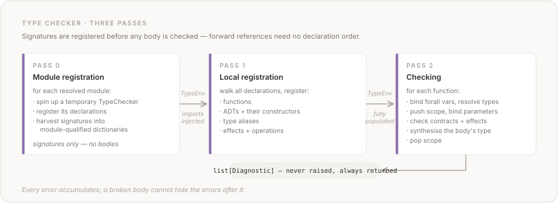
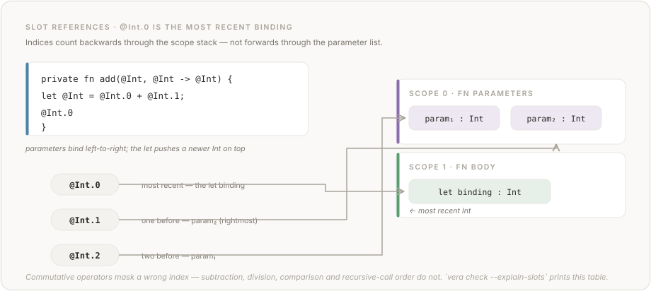
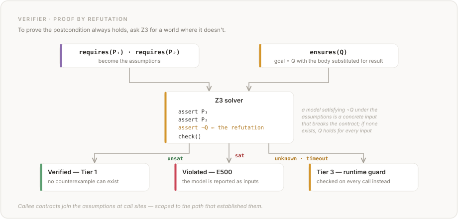
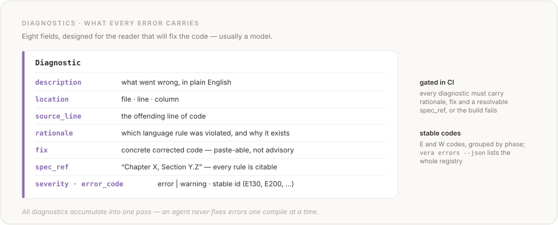

# Vera Reference Compiler

Architecture documentation for the Vera compiler (`vera/` package). This is for humans who want to understand, modify, or extend the reference implementation.

For other documentation:
- [Root README](../README.md) — project overview, getting started, language examples
- [SKILL.md](../SKILL.md) — language reference for LLM agents writing Vera code
- [spec/](../spec/) — formal language specification, a file per chapter
- [CONTRIBUTING.md](../CONTRIBUTING.md) — contributor workflow and conventions

## Pipeline Overview

The compiler is a seven-stage pipeline. Each stage consumes the output of the previous one. Each stage has a single public entry point and is independently testable.


<details>
<summary>Text version</summary>

```text
Source (.vera)
  |
  v
1   Parse        grammar.lark + parser.py     -> Lark parse tree (LALR(1))
2   Transform    transform.py + ast.py        -> typed AST
3   Resolve      resolver.py + binding.py     -> transitive module closure,
  |              every name bound to its declaration (the checker reads it)
4   Type Check   checker/ + naming.py + environment.py -> list[Diagnostic]
  |              (two passes: register every signature, then check bodies;
  |              every node typed by its identity, every generic call's
  |              instantiation recorded)
4b  Instances    typed.py                     -> the typed program: linked
  |              once, every instance derived once and judged at the call
  |              that chooses it, every clone built once and typed
  |
  +--- vera verify ------------->  5  Verify   verifier.py + smt.py (Z3)
  |                                   each obligation proved (Tier 1) or
  |                                   deferred to a runtime guard (Tier 3)
  |                                   -> ok / diagnostics / tier counts
  |                                   sidecar: obligations/ + lsp/ -- warm
  |                                   incremental re-verification (LSP)
  v    vera compile / vera run
6   Compile      codegen/ + wasm/             -> WAT + .wasm
  |              emit the typed program's clones / insert contract guards
  +------------------------------>  Browser bundle   (--target browser)
  +------------------------------>  WASI 0.2 component (--target wasi-p2)
  v
7   Execute      runtime/ + wasmtime          vera run / test / serve

Cross-cutting: cli.py (orchestrates every stage) / errors.py (Diagnostic,
E- and W-series diagnostic codes) / formatter.py (vera fmt) /
tester.py (vera test).
naming.py answers "what is this type expression called?" once -- stages 5
and 6, tester.py and lsp/ all render slot names and State/Exn cell families
through it, never their own.
Nothing exits early -- every stage accumulates diagnostics, so an agent
gets all feedback in one pass.
```

</details>

Errors never cause early exit. Parse errors raise exceptions (the tree is incomplete), but the type checker and verifier **accumulate** all diagnostics and return them as a list. This is critical for LLM consumption — the model gets all feedback in one pass.

Public entry points (from `parser.py` and `codegen/`):

```python
parse(source, file=None)        # → Lark Tree
parse_file(path)                # → Lark Tree (from disk)
parse_to_ast(source, file=None) # → Program AST
typecheck_file(path)            # → list[Diagnostic]
verify_file(path)               # → VerifyResult
compile(typed, source, file)    # → CompileResult (WAT + WASM bytes); typed = vera.typed.build(...)
execute(compile_result, ...)    # → run WASM via wasmtime
```

## Module Map

| Module | Stage | Purpose | Key API |
|--------|-------|---------|---------|
| `grammar.lark` | Parse | LALR(1) grammar definition | *(consumed by Lark)* |
| `parser.py` | Parse | Lark frontend, error diagnosis; the one reader of a source's bytes (E024) | `parse()`, `parse_file()`, `read_source()`, `decode_source()` |
| `lexical.py` | Parse | Shared lexical scanning (comment spans, blanking) | `scan_comments()`, `blank_block_comments()` |
| `transform.py` | Transform | Lark tree → AST transformer; a pipe is built as the call it stands for, and a non-call right operand is refused (E040) | `transform()` |
| `ast.py` | Transform | Frozen dataclass AST nodes, source formatting | `Program`, `Node`, `Expr`, `format_expr` |
| `types.py` | Type check | Semantic type representation | `Type`, `is_subtype()` |
| `prelude.py` | Type check | Standard prelude — built-in ADT and combinator injection | `inject_prelude()`, `prelude_adt_names()`, `overridable_builtin_names()` |
| `naming.py` | Type check | The ONE slot / slot-reference-key / State-Exn-family renderer (#1208, #1209) — the checker's rendering, as a total pure function over an `AliasEnv`, consumed by the checker, the monomorphizer, the verifier, the SMT layer, codegen, the tester, the LSP, and `vera check --explain-slots`.  Also the ONE refinement-binder derivation, from the type expression for codegen's runtime guard (`refinement_binder_parts`) and from the predicate's own reference for the verifier and SMT layers (`predicate_binder_key`, #1226), both rendering through `slot_name`; and each consumer is handed the env of the module that DECLARED what it is rendering.  Also the ONE name-resolution SPINE (`classify_named`, #1316/#1321/#1331): which branch a type name takes — type parameter, primitive, alias, declared ADT, built-in — asked by `resolve_type_expr` and by every codegen and WASM derivation that turns a name into a representation, so no consumer can hold a different branch order | `classify_named()`, `slot_name()`, `slot_ref_key()`, `family_name()`, `resolve_type_expr()`, `AliasEnv` |
| `slots.py` | Type check | Presentation over `naming.py`: slot resolution tables and their text/JSON rendering, plus the two scope walks the tables need (`forall` narrowing, `where`-helper nesting).  The walks here that are NOT naming say so in their docstrings — the alias-opaque syntactic spelling for WASM representation questions, the last-resort name for a State/Exn cell family that resolves to none, and the bare-call ownership predicate the checker, codegen, and mono discovery all resolve a `get`/`put` call site through | `slot_table()`, `format_slot_table()`, `fn_slot_scope()`, `fn_scopes()`, `type_expr_slot_name()`, `family_fallback_name()`, `bare_call_denotes_user_fn()` |
| `environment.py` | Type check | Type environment, scope stacks, ability registry; the built-in types, effects and abilities, and a `FunctionInfo` for each record of `builtins.py` | `TypeEnv`, `AbilityInfo` |
| `builtins.py` | All | The built-in registry (#735): one record per built-in function (its signature, which `TypeEnv` registers; its `since`; its lowering, by an emitter of `WasmContext` in place or through a host import, or as a prelude body; its domain), and every host import a module can declare, by family, in declaration order, with its WAT signature and the flags its declaration sets.  The checker, `_translate_call`'s dispatch, the import declarations, `vera builtins --json`, `builtin_domains.py`, `monomorphize.py`'s return tables, the scorecard, the Python host's binding table (`codegen/api.py`), the browser runtime's roster, the WASI component's refusals (each row's worlds) and spec §9's signature tables read it; a built-in's trap rows are `trap_registry.TRAP_EMITTERS`' for its emitter | `BUILTINS`, `INTRINSICS`, `HOST_IMPORTS`, `HOST_FAMILIES`, `host_import()`, `wasi_refused()`, `import_line()`, `declaration_lines()`, `cell_lines()`, `instance_name()`, `trap_rows()` |
| `checker/` | Type check | Two-pass type checker (mixin package) | `typecheck()` |
| `  core.py` | | TypeChecker class, orchestration, contracts, constraint validation | |
| `  resolution.py` | | AST TypeExpr → semantic Type, inference; the E136 / E338 refusal of a type or effect-row name nothing in scope declares (#1489), with forward references to later declarations kept legal and an instruction that names the cause; and the E340 refusal, at each entry of every row, of an entry code generation does not lower (`lowering.py` rule 6: a user-declared effect, `State` or `Exn` without a type argument, and in a function's own row a row variable) | |
| `  modules.py` | | Cross-module registration (C7b/C7c) — each module registered ONCE per run, in its own namespace with its imports' data types, and its export tables read off that registration once (#1489, #1275) — plus the per-module body check that makes a module's diagnostics independent of which file `vera check` was given (#1244) and the #1304 refusal of a bare function, data-type or constructor name two imports both supply (E155/E156/E157) | |
| `  registration.py` | | Pass 1 forward declarations, ability registration | |
| `  expressions.py` | | Expression synthesis (bidirectional), operators, statements | |
| `  eq_ability.py` | | Eq ability derivation checks | |
| `  sql.py` | | SQL literal-provenance resolution + placeholder counting (#309) | `resolve_literal_string()`, `count_placeholders()` |
| `  calls.py` | | Function/constructor/module/ability calls, and the join (`_join`, a substitution over the open type variables) that gives an array literal's elements, an `if`'s branches and a `match`'s arms one type, each position one leaves open filled by the others, bar a variable code generation compiles behaviour for and a built-in's that a parameter mentions and the arguments left unbound; a built-in's variable no parameter mentions is marked free at the call (`_mint_free_builtin_vars`); the E340 refusal of a user-declared effect's operation called under a row that does not name it (`lowering.py` rule 6); the one judgement of a built-in effect's operation (#1702), E340 for a `State` or `Exn` operation in a closure's body outside a handler written in it (rule 7) and E125 for one the row in force does not name | |
| `  control.py` | | If/match, patterns, effect handlers — the handler, cell and clause rules of `lowering.py` applied where a handler is written (E340) — and the #1233 walk that refuses (E339) a handler-clause State operation code generation cannot lower, over pushed cell families, declaration-time scopes and clause inlining, asking `lowering.py`'s shadowing rule (a type-parameter cell may be any family it unifies with, #1522), each clause visited once per inlining context | |
| `resolver.py` | Resolve | Module path resolution, parse cache, the one import-filter derivation | `ModuleResolver`, `merged_import_filters()` |
| `binding.py` | Resolve | The resolver pass (#1694): every declaration's `DeclId` (its owner — the entry file, the prelude, a module path or the built-in registry — its name, its kind, and for a `where` helper its parents), its link name (bare for the entry file and the prelude, whose names are reserved, `mod$<path>$<name>` for a module, `<parent>$where$<name>` for a helper, a constructor under its type's) and its WASM symbol in the declarations' own namespace (`$:` + link name, which no generated symbol or identifier can spell); the one binding of every call to the declaration it calls, and of every data type, alias and constructor name each namespace writes, which the checker reads; the link step, which names every declaration and occurrence by its link name, giving the program code generation compiles and the verifier verifies; and the spelling back of link names in what a run reports | `DeclId`, `Binding`, `bind_program()`, `link_program()`, `source_twins()` |
| `module_view.py` | Resolve / Type check / Compile | The ONE derivation of what a namespace sees through its imports (#1489, #1493): the module paths a namespace's imports reach (the walk the #1513 constructor fallback's reach reads too), the resolved modules a namespace reaches with `direct` re-scoped to it, and the data types it imports with every supplier, each read through `merged_import_filters()` — read by the checker's module registration and body checks and by code generation's per-module registrar and ADT membership, so a module's signatures and bodies are measured in the same namespace whichever file is the entry | `reachable_paths()`, `modules_visible_to()`, `imported_data_types()` |
| `disclosure.py` | Verify | Per-module disclosed-function manifests: each module's own verification emits the set `disclosed_fn_names` derives, keyed by owner path and carrying the `DisclosureSite` the importer's E534 cites, so the #1363 demotion crosses an import (#1399); computed BOTTOM-UP over the import DAG so each module is verified once and nothing nests, and content-addressed on the module's own source + its closure's + the budget, which is what makes an edit to an imported module invalidate it | `ModuleDisclosureIndex`, `DisclosureSite` |
| `typed.py` | Check / Verify / Compile | The typed program (#1679): the check's one link of the program, its modules and its prelude; the instances it needs, derived once from the instantiations the checker recorded at each generic call, transitively through each instance's own calls (`derive_checked`), none when a cycle of generic calls grows a type at every turn, each of whose growing calls is refused (E139, `growing_calls`); the judgments that depend on an instantiation, an ability constraint (E613), a `State` cell (E607), an `Exn` payload (E612), a handler's declared state (E533) and a `Map` or `Set` component (E135), made at the call that chooses the type arguments with the chain of instances named (`judge`); and each instance's clone, built once, renumbered and typed by its substitution, with every generic call mapped to the instance it calls (`build`, `TypedProgram`).  `verify` and `compile` take it as their one input, and read every type off it by node identity (`semantic_type`, `target_type`), a constructor's fields at a value's type included (`field_types_at`, `field_is_generic`, `constructors_of`, #1525) | `TypedProgram`, `build()`, `derive_checked()`, `growing_calls()`, `judge()` |
| `monomorphize.py` | Resolve | The clone builder: AST substitution of a type argument through a generic declaration, the type-name parse and render it spells, the injective clone mangler; each clone's De Bruijn recount renders its binder names under the **origin module's** `AliasEnv`, the one its consumers rebuild the clone's scope with (#1208) | `Monomorphizer`, `substitute_type_vars()`, `resolve_type_alias()`, `canonicalize_type_aliases()` |
| `regularity.py` | Type check / Verify | The ONE regular-recursion derivation (#1429), read PER TYPE ARGUMENT of a recursive occurrence: each must be a bare parameter of the enclosing declaration, passed along unchanged, or closed with respect to those parameters — an argument that wraps one inside another type constructor grows at every level and is refused; an occurrence of the declaration's own name must also keep its parameters in their original positions.  Asked by TWO consumers that must not disagree — the checker refuses the declaration (`E129`), and the SMT layer declines to MODEL it, because `verify()` is a public entry point whose check-clean precondition a library caller can violate and the datatype-group closure has no fixed point when it is.  A second copy would be free to drift into one consumer refusing what the other models.  Groups are the strongly connected components of one field-reference graph, so `RegularityIndex` answers for a whole module from a single pass; `recursive_group()` is the straightforward reachability walk it is differentially tested against | `RegularityIndex`, `is_regular()`, `irregular_occurrence()`, `recursive_group()` |
| `smt.py` | Verify | Z3 translation layer; reads each callee's contract in the naming env of the module that declared it (`_callee_contract_scope`, #1208), the callee itself found by its link name; a construction's sort is the sort of the checker's type of it, which the verifier hands it (`_constructed_sort`, #1525), and `Nat` and `Int` key one sort | `SmtContext`, `SlotEnv`, `CalleeScope` |
| `verifier.py` | Verify | Contract verification of the linked program (`ContractVerifier.link`, #1694): every callee is the declaration its call is bound to, looked up by its link name in one registry; an imported callee's contract and an imported generic's clone are rendered and quoted in the module that **declared** them (#1208, #1220); what a run reports quotes the program as written (`vera.binding.source_twins`); every type it reads is the typed program's, a written type's by `_written_type` and a node's by `_resolved_type_of`, a clone's under its instance's substitution, and a parameter's solver constant is named by the slot reference the source binds it to (`_parameter_slots`, #1525, #1767) | `verify()` |
| `narrowing.py` | Verify | The ONE derivation of whether a value narrows into a `@Nat` slot, read by BOTH the verifier's `guarded` claim and codegen's guard emission so the two cannot drift (#1362), each over the checker's types: `nat_narrowing()` is the rule both compose, the verifier over its semantic table and code generation over the typed program's type of each node (#1525).  `narrows_into_nat()` asks whether a value is statically non-negative (`is_static_nat_typed()`: a `@Nat` slot, a non-negative literal, arithmetic and joins over such values, a call the oracle types `@Nat`) and whether it holds a subtraction no `@Nat`-subtraction check covers (`has_underflow_leaf()`); `is_guarded_nat_subtraction()` is the one test of a `@Nat` subtraction both sides read.  For a destructured or pattern-bound component, `component_sources()` / `subcomponent_sources()` / `component_narrows()` read the constructor argument where the source builds the component and the declaration only where it is opaque, down a nested pattern's path (#1503), and `declared_component_is_nat()` reads whether that declaration types the component `Nat`; the verifier's component obligations and code generation's binder and destructure guards read the same walk (#1525).  Also the ONE roster of the construction and bind sites whose §2.6.5 refinement predicate is runtime-guarded (`REFINED_BIND_GUARDED_SITES`, #1426), CONSULTED by codegen's guard emission rather than mirrored by it, so a site is added once and the guard and the guarded status move together | `nat_narrowing()`, `is_static_nat_typed()`, `has_underflow_leaf()`, `narrows_into_nat()`, `is_guarded_nat_subtraction()`, `component_sources()`, `subcomponent_sources()`, `component_narrows()`, `declared_component_is_nat()`, `REFINED_BIND_GUARDED_SITES` |
| `callgraph.py` | Check / Verify | The ONE answer to "which functions are recursive?" (#1492): the call graph of a program's declarations, `where` helpers at every depth included, with bare calls resolved lexically as the checker resolves them, a call by the program's own module path (`ma::f(...)` in `module ma;`, #1558) as an edge to the top-level function it names, and calls in contracts and refinement predicates marked as specification edges, and its strongly connected components.  It reads what the checker's check phase reads: a refused declaration adds no function and no call, and a body the check phase skips adds no call (#1433, #815).  The checker reads it for the termination rule (`E137`) and the contract-cycle rule (`E138`); the verifier reads it for the calls a `decreases` measure is checked across, by site, so the two agree on what is recursive (#1520).  `iter_calls()` is the one enumeration of where a call can be written, a generic walk over every field: the graph draws its edges from it, and the verifier holds its measure walk to `computation_calls()`, for a generic's monomorphized clone as for a declaration the graph holds | `CallGraph`, `CallSite`, `iter_calls()`, `computation_calls()`, `declares_diverge()`, `declares_decreases()` |
| `binders.py` | Verify / Compile | The ONE enumeration of the positions the grammar binds a slot in — a function's parameters and its return, a closure's, a `let`, a destructuring `let`, a match arm's pattern and its sub-patterns, a handler clause's payload binder and its state writes, a constructor's fields, an effect operation's formals, a quantifier's variable — keyed by AST node class, with each position's guard answers beside it.  `narrowing.REFINED_BIND_GUARDED_SITES` and the verifier's two construction rosters are DERIVED from `GUARD_SITES` rather than restated, and `tests/test_binder_positions.py` holds the registry to `vera/ast.py`: every field carrying a `TypeExpr` or a `Pattern` is a registered position or an entry saying why it binds nothing, so a node class added later fails that test rather than going unvisited (#1455) | `BINDER_FIELDS`, `GUARD_SITES`, `binder_positions()`, `site_of()`, `guarded_sites()` |
| `fold.py` | Type check / Compile | The ONE traversal of the AST and the ONE table dispatch over `Expr`: `children()` reads a node's dataclass fields in declaration order (a `handle` in evaluation order, its state, its body, its clauses, `ORDER`), entering no type, pattern, effect or nested declaration, so a node class added to `ast.py` is traversed by construction, and `walk()` and `fold()` are built on it with explicit stacks; `dispatch()` builds a table keyed by expression class that refuses construction unless it names every `Expr` class, so a new class fails the import of every module that builds a `fold.dispatch` table; `scoped()` yields each node with the slots in scope, the positions read from `binders.BINDER_FIELDS` and where each is visible from `EXTENTS`, held equal to them at import; and `contexts()` yields each node with the context a consumer's step gives it, asking the step for a child's context only after the previous child's subtree and refusing a step that leaves a child out.  Code generation's expression translation and its void and WAT-type predicates, the Vera-type walk, the checker's synthesis and its SQL provenance resolvers, and the SMT layer's translation dispatch through tables, the closure free-variable walk is the scope walk, code generation's compilability pre-scan, the handler walk, is the traversal, and the verifier's `decreases`, §6.4.3 and `@Nat`-binding walks are context walks.  Imports `ast` and `binders` only | `children()`, `walk()`, `fold()`, `dispatch()`, `scoped()`, `contexts()`, `Scope`, `EXTENTS`, `ORDER` |
| `carriers.py` | Verify / Compile | The ONE enumeration of the containers whose ELEMENTS can carry a refinement — an `Array`'s elements, a `Map`'s keys and its values, a `Set`'s elements — each with the built-in that projects the container to an array of them (`map_keys` / `map_values` / `set_to_array`; an `Array` is the identity).  That projection is the only thing the three lowerings differ by, so the element fact (a bounded quantifier over the sequence's indices), the boundary guard (one loop over `ptr`/`len`) and the narrowing question are each written once against it rather than per container (#1430) | `ElementCarrier`, `element_carriers()`, `is_carrier()` |
| `trap_registry.py` | Compile / Run | The ONE statement of every runtime trap (#1479): the kinds a host can report (the code the `vera.trap` signal carries, the description, the Fix paragraph), every code-generation function that emits a check able to trap together with the verifier obligation kinds it is the runtime half of, the `EmittedCheck` record `CompileResult.emitted_checks` lists per module, the roster of every `unreachable` emitted without a signal and the causes the generic `unreachable` Fix paragraph is derived from, the natively trapping instructions — their opcodes, every way each traps, and how each host names it from the engine's trap code or reason and, where it can read one, the trapping instruction — every `throw` code generation emits, the signal's WAT, and the marker comment through which the per-module record is read back from the assembled module | `TRAP_KINDS`, `TRAP_EMITTERS`, `EmittedCheck`, `INTERNAL_TRAPS`, `UNREACHABLE_CAUSES`, `THROW_SITES`, `signal_instructions`, `native_trap_kind`, `native_trap_conditions`, `CHECK_MARKER_RE` |
| `tail_position.py` | Verify / Compile | The ONE tail-position analysis (#517): which `FnCall` nodes of a body are in tail position, and each `ModuleCall` by the module's own path, a tail call wherever the bare call would be (#1558).  Codegen lowers them to `return_call`, and the verifier reads the same answer to obligate a `decreases` measure on a self-recursive tail call's arguments, where the compiled code evaluates it before the call (#1480) | `compute_tail_call_sites()` |
| `builtin_domains.py` | Verify | The declared domains of the built-ins whose compiled translation traps (#1480): each a Vera `requires` over the built-in's parameters, written in its record in `builtins.py`, parsed once, and checked at every call by the SMT layer's call-site precondition machinery with the call's actual arguments substituted — so a literal string's byte length is exact — and recorded when discharged, since the check is made at the call | `BUILTIN_DOMAINS`, `domain_contract()` |
| `reconcile.py` | Verify / Compile | The join of the verifier's obligation records with the checks the compiled module holds (the audit's T2a): a record claiming a runtime check (`tier3`, `timeout`) that no emitted check answers is `recorded_unguarded` (E541), a check no record accounts for is `guarded_unrecorded` (W004), and a record or check the join cannot place is `no_mapping`.  The kinds a check answers are its emitter's row in `TRAP_EMITTERS`; the record sites it answers follow from the class of the node its emitter was handed — a contract clause (with the `call_pre` records at calls to its function), a parameter's or return's type (with the place inside the value the guard names, `EmittedCheck.path`), a binder, a value, a join's arms, or a `decreases` measure (with its evaluation at each tail call) — and each record is paired with the check of its own site, one to one where several records share one.  The relation itself, every record with every check standing for it whatever its status (`Reconciliation.answers`), is what `vera test --distrust` reads a trap against.  Run by `vera verify` unless `--no-reconcile` (a program holding typed holes skips it with W005), and over the corpus by `scripts/check_reconciliation.py` | `reconcile()`, `join()`, `reconcile_verified()`, `Mismatch`, `reconcile_file()`, `mismatch_diagnostics()` |
| `wasm/` | Compile | WASM translation layer (package) | `WasmContext`, `WasmSlotEnv`, `StringPool` |
| ` ├ context.py` | | Composed WasmContext, expression dispatcher, block translation; the one emission path of a named check's trap (`_emit_trap`) and its entry in the per-module record (#1479) | |
| ` ├ helpers.py` | | WasmSlotEnv, StateClauseEntry, StringPool, type mapping; also the ONE `0 .. len` element walk every boundary element guard emits (#1430), since the layers that plant them cannot share a predicate-check primitive but must not diverge on the stride or the bound | |
| ` ├ inference.py` | | The reads of the typed program (#1525): a node's checked type (`_type_of`), the width of the WAT value it is held in (`_expr_width`, `_width_of`, a written type's `_declared_width`), and the name its layout, conversion and equality are keyed by (`_type_name_of`, `_type_arg_name_of`, `_return_name_of`, rendered by `vera.types.value_type_name`), so code generation derives no type of its own; slot/type utilities, operator tables; the wasm arm of the resolution spine — `_declares_adt` (arity-aware: a spelling with a different argument count is not the declaration, #1539) and `_value_adt_key` (a value's data type by its layout key, whatever the namespace can name, #1534), the only two readers of the membership, plus every width and array-element-layout decider, all of them methods so each is asked in the namespace it is deciding for (#1321/#1331) | |
| ` ├ operators.py` | | Binary/unary operators, if, quantifiers, assert/assume, old/new | |
| ` ├ calls.py` | | Core dispatcher for `_translate_call` / `_translate_qualified_call` (a built-in lowers through its registry record's emitter, `builtins.INTRINSICS`), and a generic call's callee, the clone the typed program built for it (`_resolve_generic_call`); the domain mixins below | |
| ` ├ calls_arrays.py` | | `array_length` / `append` / `range` / `concat` / `slice` / `map` / `filter` / `fold` / `mapi` / `reverse` / `find` / `any` / `all` / `flatten` / `sort_by` | |
| ` ├ calls_containers.py` | | Map and Set (calls of the functions `hamt.py` generates, by key, value and element representation), Decimal (an opaque handle into the host's store) | |
| ` ├ hamt.py` | | `Map<K, V>` and `Set<T>` as persistent hash tries in the module's own heap (#1676): the WAT of each operation at each representation, emitted on demand, and the shared trie helpers (32-way bitmap branches, path-copying insert and remove, insertion-ordered enumeration, a `String` key's SipHash-1-3 under the key the module draws from its host once per instantiation through `hash_key`, #1736); the three a host builds and reads a `Map<String, V>` through, which the module exports | `helper_name()`, `helper()`, `closure()`, `HOST_MAPS` |
| ` ├ calls_encoding.py` | | Base64 (over a `String` and over an `Array<Byte>`), UTF-8 between `String` and `Array<Byte>`, and URL encoding/decoding/parsing | |
| ` ├ calls_handlers.py` | | Show/Hash ability dispatch, `handle[State<T>]` and `handle[Exn<E>]` | |
| ` ├ calls_markup.py` | | JSON, HTML, Markdown, Regex, async/await (#841: fused concurrent lowering for `async(Http.get/post)`, identity otherwise) | |
| ` ├ async_fusion.py` | | #841 fusion predicates — the single source of truth the `WasmContext` async/await lowering reads: which `async` call fuses, and whether a value the checker typed is a fused future (`Future<Result<String, String>>`) | `fused_async_arg_target()`, `is_fused_future_type()` |
| ` ├ calls_math.py` | | `abs`, `min`, `max`, `floor`, `ceil`, `round`, `sqrt`, `pow`, Float64 predicates, numeric conversions | |
| ` ├ calls_parsing.py` | | `parse_nat` / `parse_int` / `parse_bool` / `parse_float64` state machines | |
| ` ├ calls_strings.py` | | All string ops (length, concat, slice, search, transform, split, join, chars/lines/words, reverse, trim_start/end, pad_start/end, char_to_upper/lower, classifiers) + to-string conversions; `_translate_strip` delegates to the trim helper to keep the whitespace predicate consistent | |
| ` ├ closures.py` | | Closures, anonymous functions, free variable analysis | |
| ` ├ data.py` | | Constructors, match expressions (incl. nested patterns), arrays, indexing | |
| ` ├ markdown.py` | | WASM memory marshalling for MdInline/MdBlock ADTs | |
| ` ├ json_serde.py` | | WASM memory marshalling for Json ADT | |
| ` └ html_serde.py` | | WASM memory marshalling for HtmlNode ADT | |
| `markdown.py` | Compile | Python Markdown parser/renderer (§9.7.3 subset) | `parse_markdown()`, `render_markdown()`, `has_heading()`, `has_code_block()`, `extract_code_blocks()` |
| `markdown_grammar.py` | Compile | The §9.7.3 grammar, read by BOTH runtimes: patterns, character classes, continuation widths, and the generated copy `runtime.mjs` carries | `PATTERNS`, `CONTINUATION_INDENT`, `fence_close()`, `trim()`, `js_grammar_block()` |
| `obligations/` | Verify | Reified proof obligations + warm incremental session (#222 A/B) | `ProofObligation`, `VerificationSession` |
| `  core.py` | | ProofObligation record: identity (content_key) + discharge outcome | |
| `  cache.py` | | Invalidation keys (structural/callee/context hashes), DischargeCache; `FnCacheEntry` also carries `result_disclosed`, the one datum a replay cannot recover from the cached diagnostics and obligations (#1407); `called_name` is the one rule for which calls name a program function, a call by the program's own path included (#1558) | |
| `  session.py` | | Warm-Z3 daemon: per-function replay vs re-verify in declaration order; clears the disclosed set per program and re-enters `_verify_source_fixpoint` for one program's fixpoint (#1363) | |
| `lsp/` | Serve | Language Server Protocol over stdio (#222 C/D/E/F) | `create_server()`, `vera lsp` |
| `  convert.py` | | Span/SourceLocation/LSP coordinate conversions, UTF-16 transcoding | |
| `  documents.py` | | URI-keyed document store, full-text sync | |
| `  features.py` | | Diagnostics + tier hints, hover, slot goto (keyed through `naming.slot_ref_key`, so parameterised and alias-spelled references resolve, and a `where` helper resolves in its own accumulated scope), hole completion | |
| `  extensions.py` | | vera/speculativeEdit proof-delta | |
| `  server.py` | | pygls wiring, single-session serialisation, coroutine edit handlers | |
| `  workflows.py` | | Skill-layer workflows: enforced edit sequences, applied only through the client (#222 F, #1444) | |
| `codegen/` | Compile | Codegen orchestrator (mixin package) | `compile()`, `execute()` |
| `  api.py` | | Public API, dataclasses, `compile()`/`execute()` orchestration, core IO host bindings (#421), and the binding table that binds a module's imports through the binder of each row's family (`HOST_BINDERS`, `bind_host_imports`; #735) | |
| `  memory.py` | | Compile-time ADT layout helpers (`ConstructorLayout`, alignment) (#421) | |
| `  core.py` | | CodeGenerator class, orchestration, ability op rewriting (Pass 1.6), skip propagation to callers (#1100) | |
| `  modules.py` | | Cross-module registration + call detection (C7e), per-module alias + source scopes (#1111/#1186) — `_module_alias_scope` swaps the alias maps *and* the `AliasEnv` every codegen rendering goes through as one pair (#1208) — over the linked program, where every module declaration is already named by its link name (#1694) | |
| `  registration.py` | | Pass 1 forward declarations, ADT layout | |
| `  monomorphize.py` | | Emits the typed program's clones in a fixed order and hoists each clone's `where` helpers (Pass 1.5) | |
| `  functions.py` | | Function body compilation, GC prologue/epilogue (Pass 2); the exception boundary an export declaring `Exn<T>` is called through, which names an escaping exception `uncaught_exception` (`_exn_boundary`, #1479) | |
| `  closures.py` | | Closure lifting, GC instrumentation | |
| `  contracts.py` | | Runtime pre/postconditions, old state snapshots, decreases termination guard (entry check-and-set, per-function chain state, ADT rank helpers, self-tail site checks); the refinement boundary guard derives its binder from `naming.refinement_binder_parts` and layers the erased-base skip and the nested-base E618 on top.  Also the ONE derivation of what that guard layer lowers — `_tuple_component_guard_sites` decomposes a boundary tuple for the emitter, the return-epilogue gate and the handler walk alike, and `_signature_refinement_predicates` enumerates every predicate a signature will be guarded by (#1210) | |
| `  assembly.py` | | WAT module assembly: the host imports a module uses, declared from the registry's rows; `$alloc`, `$gc_collect` | |
| `  compilability.py` | | Compilability checks, a row entry asking `lowering.py` rule 6 as the E699 backstop; the handler walk, which refuses a function whose handler names a `State` cell or `Exn` payload no lowering exists for (E607/E612) and declares nothing, walking each function's body, its contract predicates and every signature the guard layer will check — including closures', cycle-guarded; and the declaration of a cell or tag, from the records each emitter keeps of the ones it uses, at the per-function and closure merges (#1744) | |
| `  wasi.py` | | WASI Preview 2 component/adapter emitter — `--target wasi-p2` / `--world server` (#237, #853); what each world refuses follows each registry row's WASI worlds | |
| `runtime/` | Execute | wasmtime host layer (#421): traps + per-effect host-binding families | `register_*()`, `WasmTrapError` |
| `  traps.py` | | `WasmTrapError`, `_classify_trap` / `_classify_host_error`, source-backtrace resolution, the trapping instruction a wasmtime trap stopped at (`trapping_instruction`), and the engine's own statement of a trap — its structured code (`trap_code_name`) and the reason after `Caused by:` (`trap_reason`), never the backtrace's function names; the Fix paragraphs are read from `trap_registry.TRAP_KINDS` | |
| `  heap.py` | | WASM memory marshalling primitives, ADT/Option/Array codecs, `_ShadowGuard`, and the helpers a host builds and reads a `Map<String, V>` through, which call the module's exported map functions (#1676) | |
| `  text.py` | | `safe_utf8_decode` — the single lossy-decode site (#592) | |
| `  <effect>.py` ×12 | | one `register_<effect>(linker, …)` per family: random, math, md, json, regex, html, decimal, http, async_http (#841 fused-async: worker-thread submit + blocking await + kind-4 cancel/evict decref), inference, state, db | |
| `  wasi_host.py` | | Built-in `wasi-p2` runner via `add_wasip2` — `vera run --target wasi-p2` (#237, #853); releases its store before it returns or raises and waits for wasmtime to let go of the output callbacks (`_release_store`); reads a trap's kind from the innermost adapter frame's whole name and its message from after the adapter's stderr mark (`message_mark`, #1479) | |
| `  server.py` | | `vera serve` HTTP driver for `handle(Request -> Response)` (#305) | |
| `tester.py` | Test | Z3-guided input generation (parameter types resolved through `naming.py`; a TIER-3 target whose input constraints do not all translate is skipped naming the blocker rather than trialled, while a Tier-1-proved function is reported verified and never trialled — unless `--distrust` runs it, reading each failing trial's trap against the records the reconciliation's relation says its check stands for (`reconcile.py`) as refuted (E703), a Tier-3 guard, or unattributed, and reporting a proof not exercised where no check its run reaches stands for anything it proved, or the generator cannot serve it), WASM execution, tier classification | `test()` |
| `formatter.py` | Format | Canonical code formatter | `format_source()` |
| `errors.py` | All | Diagnostic class, error hierarchy, error code registry | `Diagnostic`, `VeraError`, `ERROR_CODES` |
| `lowering.py` | Type check / Compile | What code generation lowers, one rule per construct (check implies compile): the effect a handler handles, the `State` cell and `Exn` payload, a `State` clause's resume, a quantifier's predicate and bound, the abilities lowered, an effect row's entries and an operation's effect, a `State` or `Exn` operation in a closure's body, and the E339 shadowing judgement with its re-entry cap.  The checker refuses a construct a rule refuses where it is written (E340, E179, E128, E339); code generation asks the same function at its own site, where it has one, and a refusal there is an internal error (E699).  Imports `ast`, `fold`, `types` and `narrowing`'s effect roster only | `handler_lowerable()`, `state_cell_lowerable()`, `state_clause_refusal()`, `quantifier_predicate_refusals()`, `ability_lowerable()`, `shadowing_cell()`, `effect_row_entry_refusal()`, `effect_operation_lowerable()`, `closure_operation_lowerable()` |
| `patterns.py` | Type check / Verify | A `match` pattern read to its full depth, the one reading both phases share (#1697): `head()` is what a pattern tests at its own position; `missing_cases()` the values of the scrutinee's type no arm matches, by the usefulness computation over the pattern matrix, which the checker's E311 names; and `tests()` what a pattern requires of a value, position by position, which the verifier conjoins on the constructors' accessors as the arm's condition.  Imports `ast` only | `head()`, `tests()`, `missing_cases()`, `Constructors`, `Booleans`, `Open` |
| `skip.py` | All | Codegen-internal control-flow exceptions behind structured skip diagnostics (#626) | `CodegenSkip`, `CodegenInvariantError` |
| `introspect.py` | All | Payloads for `vera builtins` / `effects` / `errors --json` | `builtins_payload()`, `effects_payload()`, `errors_payload()` |
| `envflags.py` | All | One truthiness rule for the `VERA_*` diagnostic flags catalogued in ENVIRONMENT.md; a leaf module (imports `os` only) so any layer can read a flag without a cycle | `flag_enabled()` |
| `_since.py` | All | `since` version attribution for effects, abilities and diagnostic codes (a built-in's is in its record in `builtins.py`); an unattributed effect or ability reports `null` | |
| `browser/` | Execute | Browser runtime for compiled WASM (package) | `emit_browser_bundle()` |
| ` ├ emit.py` | | Browser bundle emission (wasm + runtime + html) | `emit_browser_bundle()` |
| ` ├ runtime.mjs` | | Self-contained JS runtime: IO, State, Http, Inference, contracts, Markdown, Json, Html; every import held to the registry's rows, a roster `scripts/render_lists.py` renders | |
| ` └ harness.mjs` | | Node.js test harness for parity testing | |
| `cli.py` | All | CLI commands | `main()` |
| `command_errors.py` | All | The diagnostics a command reports about its own run, one function per code: E800, a runtime trap, and E900 to E912, the command line's own refusals (#1490) | `file_not_found()`, `runtime_trap()`, … |
| `registration.py` | Type check | Shared function registration, the checker's and the verifier's, each resolving a signature's types by the reader it passes (the verifier's reads the typed program, #1525), and the alias rule the checker resolves an alias through, whatever its declaration order (#1552) | `register_fn()`, `NamespaceAliases` |

## Parsing

**Files:** `grammar.lark`, `parser.py`

**Reading:** every command, and the module resolver for each import (the language server's among them), reads a source through `read_source()` or `decode_source()`, which decode its bytes as UTF-8 and raise `SourceEncodingError` (E024) at the first byte that does not decode, located at the file's line and column.

The grammar is a Lark LALR(1) grammar derived from the formal EBNF in spec Chapter 10. It uses:

- **String literals** for keywords (`"fn"`, `"let"`, `"match"`, etc.)
- **`?rule` prefix** to inline single-child nodes (cleaner parse trees)
- **`UPPER_CASE`** for terminal rules (`INT_LIT`, `UPPER_IDENT`, etc.)
- **Precedence climbing** for operators: pipe > implies > or > and > eq > cmp > add > mul > unary > postfix

The parser is **lazily constructed and cached** — `_get_parser()` builds the Lark parser on first call and reuses it. Lark's `propagate_positions=True` attaches source locations to every tree node, which the transformer carries through to AST `Span` objects.

**Error diagnosis:** When Lark raises an `UnexpectedToken` or `UnexpectedCharacters`, `diagnose_lark_error()` pattern-matches on the expected token set to produce LLM-oriented diagnostics. For example, if the expected set includes `"requires"` but the parser got `"{"`, the diagnostic is "missing contract block" with a concrete fix showing the `requires()`/`ensures()`/`effects()` structure.

## AST

**Files:** `ast.py`, `transform.py`
### Node hierarchy

The AST is a shallow class hierarchy. Every node is a frozen dataclass carrying an optional source `Span`.

```
Node
├── Expr                                    Expressions
│   ├── IntLit, FloatLit, StringLit         Literals
│   ├── BoolLit, UnitLit, ArrayLit, InterpolatedString
│   ├── SlotRef(@Type.n)                    Typed De Bruijn reference
│   ├── ResultRef(@Type.result)             Return value reference
│   ├── BinaryExpr, UnaryExpr              Operators
│   ├── FnCall, ConstructorCall            Calls
│   ├── QualifiedCall, ModuleCall          Qualified calls
│   ├── NullaryConstructor                 Enum-like constructors
│   ├── IfExpr, MatchExpr                  Control flow
│   ├── Block                              Block expression (stmts + expr)
│   ├── HandleExpr                         Effect handlers
│   ├── AnonFn                             Anonymous functions
│   ├── ForallExpr, ExistsExpr             Quantifiers (contracts only)
│   ├── OldExpr, NewExpr                   State snapshots (contracts only)
│   ├── AssertExpr, AssumeExpr             Assertions
│   ├── HoleExpr                           Typed hole (?)
│   └── IndexExpr                          Postfix indexing
│
├── TypeExpr                                Type expressions (syntactic)
│   ├── NamedType                          Simple and parameterised types
│   ├── FnType                             Function types
│   └── RefinementType                     { @T | predicate }
│
├── Pattern                                 Match patterns
│   ├── ConstructorPattern                 Some(@Int)
│   ├── NullaryPattern                     None, Red
│   ├── BindingPattern                     @Type (binds a value)
│   ├── IntPattern, StringPattern          0, "x"
│   ├── BoolPattern                        true
│   └── WildcardPattern                    _
│
├── Stmt                                    Statements
│   ├── LetStmt                            let @T = expr;
│   ├── LetDestruct                        let Ctor<@T> = expr;
│   └── ExprStmt                           expr; (side-effect)
│
├── Decl                                    Declarations
│   ├── FnDecl                             Function
│   ├── DataDecl                           ADT
│   ├── TypeAliasDecl                      Type alias
│   ├── EffectDecl                         Effect
│   └── AbilityDecl                        Ability
│
├── Contract                                Contract clauses
│   ├── Requires, Ensures                  Pre/postconditions
│   ├── Decreases                          Termination metric
│   └── Invariant                          Data type invariant
│
└── EffectRow                               Effect specifications
    ├── PureEffect                         effects(pure)
    └── EffectSet                          effects(<IO, State<Int>>)
```

### Transformation

`transform.py` is a Lark `Transformer` — its methods are named after grammar rules and called bottom-up. Each method receives already-transformed children and returns an AST node. Sentinel types (`_ForallVars`, `_Signature`, `_TypeParams`, `_WhereFns`, `_TupleDestruct`) aggregate intermediate results during transformation but are never exported in the final AST.

**The pipe is a call by the time any phase sees it.** `a |> f(b)` is built here as the call it stands for, `f(a, b)` — a `FnCall`, `ConstructorCall`, `QualifiedCall` or `ModuleCall`, keeping the right operand's own node type — with the pipe's span and `piped=True`, a spelling-only field (`ast._spelling`) that takes no part in equality and that the formatter reads to print the pipe back. Beside it, `stage_span` (`ast._stage`) records where the call on the right of `|>` is written: the checker places a diagnostic about the call itself there (`TypeChecker._placement`, for what a call's own check reports and what a walk over the checked program reports about a call), so in a chain it names the stage at fault, while one about the call's value stays at the pipe. A right operand that is not a call is refused here (**E040**). There is no pipe operator in `BinOp`, so no walker over `BinaryExpr` can mistake a call for an operator.

**Immutability:** All fields use tuples, not lists. All dataclasses are frozen. This means compiler phases never mutate the AST — they produce new data or collect diagnostics.

## Type Checking

**Files:** `checker/`, `naming.py`, `types.py`, `environment.py`
This is the most architecturally complex stage.

### Three-pass architecture



<details>
<summary>Text version</summary>

```text
 Pass 0: Module Registration       Pass 1: Local Registration         Pass 2: Checking
  ┌──────────────────────┐          ┌────────────────────────┐          ┌──────────────────────────┐
  │  For each resolved   │          │  Walk all declarations │          │  Walk all declarations   │
  │  module:             │          │                        │          │                          │
  │   • create temp      │          │  Register into TypeEnv:│          │  For each function:      │
  │     TypeChecker      │  TypeEnv │   • functions           │  TypeEnv │   • bind forall vars    │
  │   • register decls   │ ───────▶ │   • ADTs + constructors│ ───────▶ │   • resolve param types  │
  │   • harvest into     │ imports  │   • type aliases       │ populated│   • push scope, bind     │
  │     module-qual dicts│ injected │   • effects + ops      │          │   • check contracts      │
         │                        │          │   • synthesise body type │
         │  (signatures only,     │          │   • check effects        │
         │   no bodies checked)   │          │   • pop scope            │
         └────────────────────────┘          └──────────────────────────┘
```

</details>

**Why two passes:** Forward references and mutual recursion. A function declared on line 50 can call a function declared on line 10, or vice versa. Pass 1 makes all signatures visible before any bodies are checked.

### Syntactic vs semantic types

The compiler maintains two distinct type representations:

- **`ast.TypeExpr`** — what the programmer wrote. `NamedType("PosInt")`, `FnType(...)`, `RefinementType(...)`. These are AST nodes with source spans.
- **`types.Type`** — resolved canonical form. `PrimitiveType("Int")`, `AdtType("Option", (INT,))`, `FunctionType(...)`. These are semantic objects used for type compatibility.

`_resolve_type()` in the checker bridges them: it looks up type aliases, expands parameterised types, and resolves type variables from `forall` bindings.

**Why this matters:** Type aliases are **opaque at the head** of a slot name. If `type PosInt = { @Int | @Int.0 > 0 }`, then `@PosInt.0` counts `PosInt` bindings and `@Int.0` counts `Int` bindings — they are separate namespaces. But for type compatibility, `PosInt` resolves to a refined `Int` and subtypes accordingly.

A slot name's type **arguments** are the other half of the rule: they resolve in full, so under `type Cnt = Int` a parameter written `@Option<Cnt>` binds `Option<Int>` — one namespace with `@Option<Int>` — where `@Cnt` and `@Int` remain two ([spec §3.8.1](../spec/03-slot-references.md)). The head is the name the programmer chose for a binding, so leaving it opaque keeps a library's new alias from splitting a caller's namespace; an argument is a *component* of a structural type, so resolving it keeps one type from becoming two namespaces. A *refinement* alias resolves in argument position too, but to the predicate-elided `{@Int | ...}` form, which stays distinct from plain `Int`. `naming.py` implements all of it (Design Pattern 8).

### De Bruijn slot resolution

See [`DE_BRUIJN.md`](../DE_BRUIJN.md) for the conceptual background and worked examples. In brief: Vera uses typed De Bruijn indices instead of variable names. `@Int.0` means "the most recent `Int` binding", `@Int.1` means "the one before that".



<details>
<summary>Text version</summary>

```text
private fn add(@Int, @Int -> @Int) {        Parameters bind left-to-right.
  let @Int = @Int.0 + @Int.1;       @Int.0 = param₂ (rightmost), @Int.1 = param₁
  @Int.0                             @Int.0 = let binding (shadows param₂)
}

Scope stack after the let binding:
┌──────────────────────────────┐
│ scope 0 (fn params)          │
│   Int: [param₁, param₂]     │  ← bound left-to-right
├──────────────────────────────┤
│ scope 1 (fn body)            │
│   Int: [let_binding]         │  ← most recent
└──────────────────────────────┘

resolve("Int", 0) → let_binding    (index 0 = most recent)
resolve("Int", 1) → param₂         (index 1 = one before)
resolve("Int", 2) → param₁         (index 2 = two before)
```

</details>

The resolver walks scopes **innermost to outermost**, counting backwards within each scope. This is implemented in `TypeEnv.resolve_slot()`.

Each binding tracks its **source** (`"param"`, `"let"`, `"match"`, `"handler"`, `"destruct"`) and its **canonical type name** — the name slot references match against, rendered by `naming.py`. Alias opacity applies to that name's **head** only: `@PosInt.0` never counts `Int` bindings, while a parameter written `@Option<Cnt>` under `type Cnt = Int` binds `Option<Int>` and is reached by `@Option<Int>.0` (spec §3.8.1).

### Subtyping

The subtyping rules (in `types.py`) are:

- `Nat <: Int` — naturals are integers
- `Never <: T` — bottom type subtypes everything
- `{ T | P } <: T` — refinement types subtype their base
- `TypeVar("T") <: TypeVar("T")` — reflexive equality only; TypeVars are not compatible with concrete types
- `AdtType` — structural: same name + covariant subtyping on type arguments

### Error accumulation

The type checker **never raises exceptions** for type errors. All errors are collected as `Diagnostic` objects in a list. When a subexpression has an error, `UnknownType` is returned instead — this prevents cascading errors (e.g., one wrong type causing ten downstream mismatches).

Context flags (`in_ensures`, `in_contract`, `current_return_type`, `current_effect_row`) control context-sensitive checks: `@T.result` is only valid inside `ensures`, `old()`/`new()` only in postconditions, etc.

### Built-ins

`TypeEnv._register_builtins()` registers the built-in types, effects and abilities, and a function for each record of the built-in registry, `builtins.py`. Function names follow the `domain_verb` convention (see spec §9.1.1): `string_` prefix for string ops, `float_` prefix for float predicates, `source_to_target` for conversions, prefix-less for math universals only (`abs`, `min`, `max`, etc.). New built-in functions must follow these patterns.

The **standard prelude** automatically provides `Option<T>`, `Result<T, E>`, `Ordering`, and `UrlParts` in every program without explicit `data` declarations (and `Json`, `HtmlNode`, `Request` and `Response` when a program mentions them), along with Option/Result combinators and the array built-ins (including `array_length`, `array_append`, `array_range`, `array_concat`, `array_slice`, `array_map`, `array_filter`, `array_fold`, `array_mapi`, `array_reverse`, `array_find`, `array_any`, `array_all`, `array_flatten`, `array_sort_by`). User-defined `data` declarations with the same name shadow the prelude.

| Built-in | Kind | Details |
|----------|------|---------|
| `Option<T>` | ADT | `None`, `Some(T)` constructors |
| `Result<T, E>` | ADT | `Ok(T)`, `Err(E)` constructors |
| `Future<T>` | ADT | `Future(T)` constructor — WASM-transparent wrapper |
| `MdInline` | ADT | `MdText(String)`, `MdCode(String)`, `MdEmph(Array<MdInline>)`, `MdStrong(Array<MdInline>)`, `MdLink(Array<MdInline>, String)`, `MdImage(String, String)` |
| `MdBlock` | ADT | `MdParagraph(Array<MdInline>)`, `MdHeading(Nat, Array<MdInline>)`, `MdCodeBlock(String, String)`, `MdBlockQuote(Array<MdBlock>)`, `MdList(Bool, Array<Array<MdBlock>>)`, `MdThematicBreak`, `MdTable(Array<Array<Array<MdInline>>>)`, `MdDocument(Array<MdBlock>)` |
| `State<T>` | Effect | `get(Unit) → T`, `put(T) → Unit` operations |
| `IO` | Effect | `print`, `read_line`, `read_char`, `read_file`, `write_file`, `read_bytes`, `write_bytes`, `args`, `exit`, `get_env`, `sleep`, `time`, `stderr` |
| `Async` | Effect | No operations — marker for async computation |
| `Diverge` | Effect | No operations — marker for non-termination |
| `array_length` | Function | `forall<T> Array<T> → Int`, pure |
| `array_append` | Function | `forall<T> Array<T>, T → Array<T>`, pure |
| `array_range` | Function | `Int, Int → Array<Int>`, pure |
| `array_concat` | Function | `forall<T> Array<T>, Array<T> → Array<T>`, pure |
| `array_slice` | Function | `forall<T> Array<T>, Int, Int → Array<T>`, pure |
| `array_map` | Function | `forall<A, B> Array<A>, fn(A → B) pure → Array<B>`, pure |
| `array_filter` | Function | `forall<T> Array<T>, fn(T → Bool) pure → Array<T>`, pure |
| `array_fold` | Function | `forall<T, U> Array<T>, U, fn(U, T → U) pure → U`, pure |
| `array_mapi` | Function | `forall<A, B> Array<A>, fn(A, Nat → B) pure → Array<B>`, pure |
| `array_reverse` | Function | `forall<T> Array<T> → Array<T>`, pure |
| `array_find` | Function | `forall<T> Array<T>, fn(T → Bool) pure → Option<T>`, pure |
| `array_any` | Function | `forall<T> Array<T>, fn(T → Bool) pure → Bool`, pure |
| `array_all` | Function | `forall<T> Array<T>, fn(T → Bool) pure → Bool`, pure |
| `array_flatten` | Function | `forall<T> Array<Array<T>> → Array<T>`, pure |
| `array_sort_by` | Function | `forall<T> Array<T>, fn(T, T → Ordering) pure → Array<T>`, pure |
| `string_length` | Function | `String → Nat`, pure |
| `string_concat` | Function | `String, String → String`, pure |
| `string_slice` | Function | `String, Nat, Nat → String`, pure |
| `string_char_code` | Function | `String, Int → Nat`, pure |
| `string_from_char_code` | Function | `Nat → String`, pure |
| `string_repeat` | Function | `String, Nat → String`, pure |
| `parse_nat` | Function | `String → Result<Nat, String>`, pure |
| `parse_int` | Function | `String → Result<Int, String>`, pure |
| `parse_float64` | Function | `String → Result<Float64, String>`, pure |
| `parse_bool` | Function | `String → Result<Bool, String>`, pure |
| `base64_encode` | Function | `String → String`, pure (RFC 4648) |
| `base64_decode` | Function | `String → Result<String, String>`, pure |
| `base64_encode_bytes` | Function | `Array<Byte> → String`, pure (RFC 4648) |
| `base64_decode_bytes` | Function | `String → Result<Array<Byte>, String>`, pure |
| `string_to_bytes` | Function | `String → Array<Byte>`, pure (the string's UTF-8 bytes) |
| `bytes_to_string` | Function | `Array<Byte> → Result<String, String>`, pure (UTF-8 decode) |
| `url_encode` | Function | `String → String`, pure (RFC 3986 percent-encoding) |
| `url_decode` | Function | `String → Result<String, String>`, pure |
| `url_parse` | Function | `String → Result<UrlParts, String>`, pure (RFC 3986 decomposition) |
| `url_join` | Function | `UrlParts → String`, pure (reassemble URL) |
| `md_parse` | Function | `String → Result<MdBlock, String>`, pure (Markdown → typed AST) |
| `md_render` | Function | `MdBlock → String`, pure (typed AST → canonical Markdown) |
| `md_has_heading` | Function | `MdBlock, Nat → Bool`, pure (query heading level) |
| `md_has_code_block` | Function | `MdBlock, String → Bool`, pure (query code block language) |
| `md_extract_code_blocks` | Function | `MdBlock, String → Array<String>`, pure (extract code by language) |
| `async` | Function | `T → Future<T>`, `effects(<Async>)` (generic, eager evaluation) |
| `await` | Function | `Future<T> → T`, `effects(<Async>)` (generic, identity unwrap) |
| `to_string` | Function | `Int → String`, pure |
| `int_to_string` | Function | `Int → String`, pure (alias for `to_string`) |
| `bool_to_string` | Function | `Bool → String`, pure |
| `nat_to_string` | Function | `Nat → String`, pure |
| `byte_to_string` | Function | `Byte → String`, pure |
| `float_to_string` | Function | `Float64 → String`, pure |
| `string_strip` | Function | `String → String`, pure (zero-copy) |
| `abs` | Function | `Int → Nat`, pure |
| `min` | Function | `Int, Int → Int`, pure |
| `max` | Function | `Int, Int → Int`, pure |
| `floor` | Function | `Float64 → Int`, pure |
| `ceil` | Function | `Float64 → Int`, pure |
| `round` | Function | `Float64 → Int`, pure |
| `sqrt` | Function | `Float64 → Float64`, pure |
| `pow` | Function | `Float64, Int → Float64`, pure |
| `int_to_float` | Function | `Int → Float64`, pure |
| `float_to_int` | Function | `Float64 → Int`, pure |
| `nat_to_int` | Function | `Nat → Int`, pure |
| `int_to_nat` | Function | `Int → Option<Nat>`, pure |
| `byte_to_int` | Function | `Byte → Int`, pure |
| `int_to_byte` | Function | `Int → Option<Byte>`, pure |
| `float_is_nan` | Function | `Float64 → Bool`, pure |
| `float_is_infinite` | Function | `Float64 → Bool`, pure |
| `nan` | Function | `→ Float64`, pure |
| `infinity` | Function | `→ Float64`, pure |
| `string_contains` | Function | `String, String → Bool`, pure |
| `string_starts_with` | Function | `String, String → Bool`, pure |
| `string_ends_with` | Function | `String, String → Bool`, pure |
| `string_index_of` | Function | `String, String → Option<Nat>`, pure |
| `string_upper` | Function | `String → String`, pure |
| `string_lower` | Function | `String → String`, pure |
| `string_replace` | Function | `String, String, String → String`, pure |
| `string_split` | Function | `String, String → Array<String>`, pure |
| `string_join` | Function | `Array<String>, String → String`, pure |

Additionally, `resume` is bound as a temporary function inside handler clause bodies (in `_check_handle()`). Its type is derived from the operation: for `op(params) → ReturnType`, `resume` has type `fn(ReturnType) → Unit effects(pure)`. The binding is added to `env.functions` before checking the clause body and removed afterward.

## Contract Verification

**Files:** `verifier.py`, `smt.py`
### Tiered model

The spec defines three verification tiers. The compiler implements Tiers 1 and 3:

| Tier | What | How | Status |
|------|------|-----|--------|
| **1** | Decidable fragment: QF_LIA + Booleans + comparisons + if/else + let + match + constructors + `array_length` + decreases | Z3 proves automatically | Implemented |
| **2** | Extended: quantifiers, function call reasoning, array access | Z3 with hints/timeouts | Not implemented |
| **3** | Everything else | Runtime assertion fallback | Warning emitted |

When a contract or function body contains constructs that can't be translated to Z3, the verifier **does not error** — it classifies the contract as Tier 3 and emits a warning. So an untranslatable construct never fails verification on its own.

### Verification condition generation



<details>
<summary>Text version</summary>

```text
 requires(P₁), requires(P₂)           ensures(Q)
         │                                 │
         ▼                                 ▼
  assumptions = [P₁, P₂]          goal = Q[result ↦ body_expr]
         │                                 │
         └────────────┬────────────────────┘
                      ▼
               ┌─────────────┐
               │  Z3 Solver  │
               │             │
               │  assert P₁  │   Refutation: if ¬Q is satisfiable
               │  assert P₂  │   under the assumptions, there's a
               │  assert ¬Q  │   counterexample. If unsatisfiable,
               │             │   the postcondition always holds.
               │  check()    │
               └──────┬──────┘
                      │
            ┌─────────┼──────────┐
            ▼         ▼          ▼
         unsat       sat      unknown
        Verified   Violated    Tier 3
                  + counter-
                   example
```

</details>

**Forward symbolic execution:** The function body is translated to a Z3 expression, and `@T.result` in postconditions is substituted with this expression. This is simpler than weakest-precondition calculus and equivalent for the non-recursive straight-line code that Tier 1 handles.

**Trivial contract fast path:** `requires(true)` and `ensures(true)` are detected syntactically (`BoolLit(true)`) and counted as Tier 1 verified without invoking Z3. Most example programs use `requires(true)`, so this avoids unnecessary solver overhead.

### SMT translation

`SmtContext` in `smt.py` translates AST expressions to Z3 formulas. It returns `None` for any construct it can't handle — this triggers Tier 3 gracefully.  Every sort is the sort of a type the checker gave: a slot's of its declaration's resolved type, and a construction's of its own, a type variable left open there taking the type its position fixes, else `Int` (`ContractVerifier._constructed_type_of`); `Nat` and `Int` are one sort, as a refinement and its base are (#1525).

`SlotEnv` mirrors the De Bruijn scope stack with Z3 variables. It's immutable: `push()` returns a new environment. `resolve(T, n)` computes `stack[len - 1 - n]`.

| AST construct | Z3 translation |
|---------------|----------------|
| `IntLit(v)` | `z3.IntVal(v)` |
| `BoolLit(v)` | `z3.BoolVal(v)` |
| `SlotRef(T, n)` | `env.resolve(T, n)` |
| `ResultRef(T)` | `result_var` |
| `+`, `-`, `*`, `/`, `%` | Z3 integer arithmetic |
| `==`, `!=`, `<`, `>`, `<=`, `>=` | Z3 comparison |
| `&&`, `\|\|`, `==>` | `z3.And`, `z3.Or`, `z3.Implies` |
| `!`, `-` (unary) | `z3.Not`, negation |
| `if c then t else e` | `z3.If(c, t, e)` |
| `array_length(arr)` | Uninterpreted function, constrained `>= 0` |
| `abs(x)` | `z3.If(x >= 0, x, -x)` |
| `min(a, b)` | `z3.If(a <= b, a, b)` |
| `max(a, b)` | `z3.If(a >= b, a, b)` |
| `nat_to_int(x)` | Identity (both IntSort) |
| `byte_to_int(x)` | Identity (both IntSort) |
| `let @T = v; body` | Push `v` onto `SlotEnv`, translate body |
| `match ... { arms }` | Nested `z3.If` chain with recognizer conditions |
| A constructor (`None`, `Some(v)`, `Cons(a, b)`) | The constructor of the Z3 datatype of its checked type |
| `decreases(e)` | Verified via `e_callee < e_caller` (Nat) or rank function (ADT) |
| Handle, lambda, quantifier, old/new | `None` (Tier 3) |

### Disclosed facts, and how they cross an import

A declared-type fact is sound to assume only while the obligation establishing it was **discharged**.  When the run instead *disclosed* it — reported it as neither proved nor guarded — a caller's proof that needs it rests on something the run admitted it could not establish, so `check_valid` withholds such facts from the first attempt and reports a goal that then needs them as `disclosed`, which the verifier records as Tier 3 with **E534** (#1363).  `disclosed_fn_names()` is the ONE derivation of which functions are in that state, read by the cold `verify_program` fixpoint and by the warm session alike.

It reads the run's obligation stream, and an imported callee's obligations are never in it — the importer harvests contracts, not proofs.  `disclosure.py` supplies the missing half (#1399): a `ModuleDisclosureIndex` built from the resolved-module closure answers "what did module *p* disclose?" by running *p*'s own verification and asking the same `disclosed_fn_names()`, so a library's disclosure reaches its importers without the importer carrying the library's obligation stream.  Three properties keep it honest:

- **Lazy, and bottom-up.** A module is verified only when a call this walk already found carries declared-type facts asks about it, so importing a module costs nothing until it matters. The first ask then computes every manifest the target depends on in dependency order, so each module is verified exactly once and its imports' answers are already cached when its own verification runs. Answering lazily and letting the answer recurse looks equivalent and is not: it nests one whole verify pipeline per import hop, which is quadratic in the chain and bounded by the interpreter's stack rather than by the closure — a 70-module chain reported `E699` on a program that verifies clean without the manifest at all. Both DAG walks are iterative for the same reason, and the sub-checks share one `body_check_memo` so a module's bodies are checked once for the whole closure.
- **Content-addressed.** The cache key is the module's own source, its transitive closure's sources, and the solver budget — the complete set of inputs its disclosed set is a function of.  A diamond pays once; an edit to any module in the closure is a different key, which is what makes invalidation automatic for the warm `VerificationSession` rather than a step someone has to remember.
- **Transitive by recursion.** Computing A's manifest runs A's own verification, which builds its own index over A's closure and asks it about B.  A three-hop chain taints hop by hop with no special case.

`_scrutinee_is_disclosed_call` checks the two places a disclosure can live: this run's set (local callees, and every imported generic whose clone this run verifies, under its link name, which is the name the linked program calls it by) and the defining module's manifest.  A call of an imported function reaches the manifest through the declaration its link name names (`_decl_of_link`, the module and name the resolver pass bound the call to) — but only once `_local_fn_names_in_scope` has confirmed the call is not answered lexically first.  That set is the program's `where` helpers on the call's chain and its top-level functions, as NAMES rather than resolved infos: the disclosure fixpoint re-registers the program with fresh info objects while the registry keeps the first pass's, so an identity comparison answers True on pass one and False on pass two.

Each consulted disclosure records its `DisclosureSite`, and the demotion cites it: across an import the library's `E504` is in the library's run, which the importer discards by design, so `"a fact this run could neither prove nor guard"` names nothing the reader can go and look at — and is not true of the importing run, which reported no such thing.  The sites are per-function state with the same lifetime as the withheld facts they describe.

### Counterexample extraction

When Z3 finds a satisfying assignment to the negated postcondition (= a counterexample), the verifier extracts concrete values from the Z3 model and includes them in the diagnostic:

```
Error at line 3, column 3:
  Postcondition may not hold: @Int.result > @Int.0

  Counterexample: @Int.0 = 0, @Int.1 = -5
  The Z3 solver found concrete inputs where the postcondition fails.

  Fix: strengthen the requires() clause or weaken the ensures() clause.
  See: Chapter 6, Section 6.4 "Verification Conditions"
```

## Code Generation

**Files:** `codegen/`, `wasm/` (split into domain mixins, which the module map above lists)

### Compilation pipeline

`compile()` in `codegen/api.py` takes the typed program a clean check built (`vera.typed.build(...)`), the source text and the file name, and produces a `CompileResult` containing WAT text, WASM bytes, export names, and diagnostics.

```
TypedProgram → CodeGenerator._register_functions()  (pass 1)
             → CodeGenerator._compile_functions()   (pass 2)
             → WAT module text
             → wasmtime.wat2wasm() → WASM bytes
```

The two-pass architecture mirrors the type checker: pass 1 registers all function signatures so forward references and mutual recursion work, pass 2 compiles bodies.

### WASM translation

`WasmContext` in `wasm/` mirrors `SmtContext` in `smt.py`. It translates AST expressions to WAT instructions via `translate_expr()`, which dispatches on AST node type. Returns `None` for unsupported constructs (graceful degradation, same pattern as SMT translation).

`WasmSlotEnv` mirrors `SlotEnv` — it maps typed De Bruijn indices (`@T.n`) to WASM local indices. Immutable: `push()` returns a new environment.

### String pool

`StringPool` manages string constants in the WASM data section. Identical strings are deduplicated. Each string gets an `(offset, length)` pair. `StringLit` compiles to two `i32.const` instructions pushing the pointer and length.

### IO host bindings

`IO.print` compiles to a call to an imported host function. The `execute()` function in `codegen/api.py` provides the host implementation via wasmtime's `Linker`: it reads UTF-8 bytes from WASM linear memory and writes to stdout (or a capture buffer for testing). The IO host functions stay inline in `execute()` — unlike the other effects, which are factored into `vera/runtime/`. See **Host-binding families** below for the rationale.

### Host-binding families (`vera/runtime/`)

Every host import a module can declare is a row of the built-in registry, `builtins.py` ([#735](https://github.com/aallan/vera/issues/735)): its name, its WAT signature, its family, and the flags its declaration sets.  Code generation declares the rows a module uses; the families below implement them.  `execute()` lives in `codegen/api.py`; the wasmtime host layer is factored into `vera/runtime/` ([#421](https://github.com/aallan/vera/issues/421)): trap classification (`traps.py`), WASM memory marshalling (`heap.py`), and **one module per optional effect family**, each exposing a single `register_<family>(linker, …)` that defines and registers its host callbacks. `execute()` binds a module's imports through `HOST_BINDERS`, the binder of each import's row's family, so the module's imports are bound exactly, and an import no row declares, or one no binder defines, is a `HostBindingError` naming the row. The compiled `.wasm` import interface does not depend on this layout — it is internal structure, not a contract.


**What counts as a "family" module.** Each of the twelve (`random`, `math`, `md`, `json`, `regex`, `html`, `decimal`, `http`, `async_http`, `inference`, `state`, `db`) is a *pluggable adapter* with minimal coupling to `execute()`. Decimal marshals opaque handles; Json/Html/Markdown/Regex bridge Python parsers; Http/Inference wrap network calls; Db opens one connection per run, captured by its op closures; Random/Math/State are thin shims. Most are stateless, each bound when the module declares an import of its family. The three stateful ones — Decimal, State, and the fused Async adapter — keep a single Python-side store that `execute()` creates and reads back (Decimal's handle store feeds the GC decref hook and `host_store_sizes`; State's cell stacks feed `ExecuteResult.state`; `async_http.py`'s `register_async` takes the `future_store` `execute()` builds up-front, publishes it as `host_store_refs["future"]` so it too reaches `host_store_sizes`, and has its entries evicted by the same `host_decref_handle` — kind 4, which also cancels a future that never started, #841), passed as one explicit parameter (e.g. `register_decimal(linker, ops, decimal_store, host_store_refs)`), keeping each family a clean unit. `heap.py` holds the marshalling primitives they all call.

**Why IO is *not* a family module.** IO stays inline in `execute()` by design. Unlike the twelve adapters, IO is execute()'s **observation channel**: its host callbacks write into state that *becomes the return value* — `output_buf`/`stderr_buf` → `ExecuteResult.stdout`/`stderr`, `last_violation` → the trap diagnostic via `_classify_trap`, `tee_stdout` → the live-streaming decision — and it shares the `_VeraExit` Ctrl-C exception with execute()'s exit handling. Extracting the adapters *reduced* coupling (each became self-contained); extracting IO would not — it would relocate a naturally cohesive unit across a file boundary behind a 7-field context object that both the host callbacks and the result-building code would thread through. Cohesion of a genuinely-coupled unit outweighs uniform "every effect lives in `runtime/`" placement. (By Vera's *surface* model IO is an effect like any other; by the *compiler's* internal structure it is execute()'s I/O substrate. The decomposition follows the compiler's structure — the principle that each module be a cohesive, independently-testable unit.)

### Markdown host bindings

`markdown.py` implements a hand-written Python Markdown parser and renderer (§9.7.3 subset). This is the **first set of pure functions implemented as host bindings** rather than inline WASM. The architectural rationale:

- Markdown parsing is too complex for inline WASM (recursive tree construction, regex-based tokenization)
- Functions are genuinely pure (deterministic, referentially transparent) — the host implementation is part of the trusted computing base
- No external dependency — the parser handles ATX headings, fenced code blocks, paragraphs, lists, block quotes, GFM tables, thematic breaks, and inline formatting (emphasis, strong, code, links, images)

`wasm/markdown.py` provides bidirectional WASM memory marshalling for the `MdInline` and `MdBlock` ADT trees. Write direction (`write_md_inline`, `write_md_block`) allocates ADT nodes in WASM linear memory using the same `$alloc` + tag-dispatch layout as user-defined ADTs. Read direction (`read_md_inline`, `read_md_block`) reconstructs Python objects from WASM memory. Helper functions `_read_i32`, `_read_i64`, and `_write_i64` handle raw memory access for struct fields.

The WASM import interface is the portability contract: the compiled `.wasm` binary declares `(import "vera" "md_parse" ...)` etc., and any host runtime provides matching implementations. The Python implementation in `vera/runtime/md.py` (over `vera/markdown.py`) is the reference; the browser runtime in `browser/runtime.mjs` provides JavaScript host bindings with the same WASM memory allocation protocol.

### Browser runtime

`browser/runtime.mjs` is a self-contained JavaScript runtime that provides JavaScript implementations of all Vera host bindings. It works with any core Vera `.wasm` module — the default and browser targets share one import ABI, so no code generation is needed; the `--target wasi-p2` component is a different artifact format with its own host.

**Dynamic import introspection:** Instead of generating per-program glue code, the runtime uses `WebAssembly.Module.imports(module)` at initialization to discover which host functions the module actually needs, then builds the import object dynamically. State\<T\> types are pattern-matched from `state_get_*`/`state_put_*` import names. Every import is then held to the runtime's roster of the registry's rows, which `scripts/render_lists.py` renders from `HOST_IMPORTS`: an import no row declares, or one the runtime does not bind, is refused naming the row.

**Browser adaptations:** IO operations have browser-appropriate implementations. `IO.print` captures output in a buffer (flushed via `getStdout()`). `IO.read_line` reads from a pre-queued input array or falls back to `prompt()`. File IO returns `Result.Err("File I/O not available in browser")`. `IO.exit` throws a `VeraExit` error. `Inference.complete` returns `Result.Err(...)` with an explanation — embedding API keys in client-side JavaScript exposes them in page source and network requests; the recommended pattern is a server-side proxy called via the `Http` effect.

**Bundled Markdown parser:** The runtime includes a JavaScript Markdown parser (bundled inline) matching the Python §9.7.3 subset. Zero external dependencies.

**GC reachability discipline (JS host side):** JS host functions that allocate multiple WASM heap blocks and hold intermediates in JS locals must root those intermediates on the shadow stack — otherwise EAGER_GC (and, under pressure, normal GC) reclaims them mid-walk. The runtime exports two helpers: `gcShadowPush(ptr)` writes a pointer to `$gc_sp` and advances it (throws if `$gc_sp` / `$gc_stack_limit` aren't exported, since that means the module was built without GC support but is calling allocators that can trigger GC), and `gcGuard(fn)` saves `$gc_sp` at entry and restores it on exit (success or exception). This is the browser parallel of the CLI-side `_ShadowGuard` context manager ([#692](https://github.com/aallan/vera/issues/692)). The walkers `writeJson` / `writeHtml` and the parsers `json_parse` / `html_parse` wrap their bodies in `gcGuard` and push intermediates (`arrPtr`, `wrapperPtr`, `jsonPtr`) as soon as each is allocated — see `runtime.mjs` for the canonical pattern. Without this, `Map<K, Json>` / `Set<Json>` and similar heap-pointer-keyed collections drop values under GC pressure (#708).

**Parity enforcement:** `tests/test_browser.py` runs the examples the browser target can execute — two explicit lists in that file, not the whole `examples/` directory, since an example that reads stdin interactively, uses a refused host family (file IO, `DB`), or does not compile standalone cannot be compared — plus per-binding batteries over the Decimal/Json/Regex/Markdown host imports, through both Python/wasmtime and Node.js/JS-runtime, and over `Map` and `Set`, which are the module's own code (#1676) and stay as a regression on the JSON and HTML hosts that build and read maps through it. The two example lists carry different oracles: the examples exporting `main` are run and compared on stdout, while the ones reached as exported functions are called with fixed arguments and compared on the returned value. The per-binding batteries compare stdout. `json_stringify` and `md_render` are compared the same way and additionally against the canonical form the specification states for each (§9.7.1, §9.7.3), because cross-host equality alone would be satisfied by two hosts agreeing on a wrong answer; `md_render` is also asserted stable under re-render and exercised on `MdBlock` values the test *builds*, since several renderer rules are unreachable through `md_parse`, and `json_stringify`'s number rendering is checked differentially against a real `JSON.stringify`. `json_parse` is compared by accepted domain, the parse-side counterpart: §9.7.1 states the domain — RFC 8259-valid text that decodes to finite numbers and strings of Unicode scalar values — and the battery compares the whole `Err` message across hosts for the JavaScript constants, for a number that overflows to an infinity in either spelling — with an exponent (`1e999`) or as plain digits (`1` followed by 309 zeros, the route `json.loads` decodes to an `int`) — and for a lone-surrogate escape, parameterised over every position a string can occupy (value, key, array element, nested), beside controls the refusals must not disturb: matched surrogate pairs, `"NaN"` as an ordinary string value, the finite boundary values, underflow to `0`, and the band between the largest finite double and the rounding boundary, whose integers are larger than `sys.float_info.max` and still accepted by both hosts. `md_parse` is compared by ADT: §9.7.3 states the grammar, `vera/markdown_grammar.py` holds its patterns once and the browser runtime carries a generated copy the suite asserts verbatim, and a generated corpus — the divergence classes #1301 measured, every block-opening line template taken one, two and three at a time, every inline shape in the four positions that reach the inline parser, a carriage-return leg and a seeded fuzz leg — is parsed by both hosts with the trees compared byte for byte, because a comparison routed through `md_render` cannot see how a paragraph's plain-text runs are grouped. The browser stubs are covered on two different shapes: `IO.read_file` and `IO.write_file` get the same per-host pinning, run through both runtimes against a path that really is readable or writable so the native `Ok` and the browser `Err` are each asserted (a missing file or an unwritable directory would `Err` on both sides and prove nothing), while `IO.read_char` is exercised in Node alone — the module links and the stub's `Err` arm returns `0` — with no native run to compare against. `Inference` and `DB` return `Err` from every browser operation, which is a deliberate platform boundary — the credentials they need would be readable from page source — rather than a divergence awaiting a fix. Pre-commit hooks and CI trigger these tests on any change to the host binding surface.

`browser/emit.py` provides `emit_browser_bundle()` for the `vera compile --target browser` CLI command, which produces a ready-to-serve directory (module.wasm + runtime.mjs + index.html).

### Runtime contracts

The code generator does **not** consult the verifier: `vera compile` emits the module — with its contract guards — whether or not `vera verify` ever ran. Tier classification is `vera verify`'s *reporting*, not a codegen input:
- **Trivial (`requires(true)`, `ensures(true)`):** omitted — recognised syntactically, no meaningful check
- **Everything else:** compiled as runtime assertions using `unreachable` traps, whether Z3 proved it (Tier 1) or deferred it (Tier 3)

Omitting statically-proven guards is the spec §11.8 aspiration tracked in [#958](https://github.com/aallan/vera/issues/958) — it must wait on the soundness guarantees noted there.

`vera verify` compiles the program in process and joins the verifier's records with the checks the module holds (`reconcile.py`): a record claiming a runtime check that no emitted check answers is an E541 error, and an emitted check no record accounts for is a W004 warning.  `--no-reconcile` skips the join.  `tests/test_reconciliation.py` runs the same join over the corpus in CI, and `scripts/check_reconciliation.py` locally, with the known mismatches allowlisted by their open issues.

Preconditions are checked at function entry. Postconditions store the return value in a temporary local, check the condition, and trap or return.

**Informative violation messages:** Before each `unreachable`, the codegen emits a call to the `vera.contract_fail` host import with a pre-interned message string describing which contract failed (function name, contract kind, expression text). The host callback stores the message; when the trap is caught, `execute()` raises a `RuntimeError` with the stored message instead of a raw WASM trap. `format_expr()` and `format_fn_signature()` in `ast.py` reconstruct source text from AST nodes for the message.  Every other named check calls `vera.trap(kind, ptr, len)` the same way — its kind as a code from `vera/trap_registry.py`'s `TRAP_KINDS`, and its own message where it carries one — through the single emission path `WasmContext._emit_trap`, which also raises the import's flag and records the check in `CompileResult.emitted_checks` (#1479).  An export whose effect row declares `Exn<T>` is exported through a boundary (`FunctionCompilationMixin._exn_boundary`) that catches an exception leaving it and signals `uncaught_exception` with its type and the value thrown.  Every `unreachable` emitted without a signal is on that module's `INTERNAL_TRAPS` roster, from which the generic `unreachable` Fix paragraph is derived; `tests/test_named_traps_1479.py` scans the code-generation package to hold the two together.

### Memory management

Memory is managed automatically. The allocator and garbage collector are implemented entirely in WASM — no host-side GC logic.

**Memory layout** (when the program allocates):

```
[0, data_end)            String constants (data section)
[data_end, +16K)         GC shadow stack (4096 root slots)
[data_end+16K, +80K)     GC mark worklist (16384 entries)
[data_end+80K, +144K)    GC wrapper table (4096 entries; only with host-backed values)
[data_end+80K or +144K, ...)  Heap (objects with 4-byte headers)
```

**Allocator** (`$alloc` in `assembly.py`): Bump allocator with free-list overlay. Each allocation prepends a 4-byte header (`mark_bit | size << 1`). Allocation tries free-list first-fit, then bump, triggers GC on OOM, falls back to `memory.grow`.

**Garbage collector** (`$gc_collect` in `assembly.py`): Conservative mark-sweep:
1. **Clear** — walk the heap along the allocation chain from `$gc_heap_start` to `$heap_ptr`, clearing every mark bit and recording each object's base address in a transient bitmap, one bit per 8-byte granule, laid out just above `$heap_ptr` (#1382), then walk the free list and clear the bit of each block on it (`$gc_clear_base`), so the mark phase never marks a free block, which keeps its old payload behind the free-list link (#1718)
2. **Mark** — seed the worklist from the shadow stack, then drain it: pop an object, skip it if it is marked, mark it, and scan every i32-aligned word of its payload, the scan bounded by `$heap_ptr` (#515). A word is pushed when it lies in the heap, is aligned as a payload address and is recorded in the bitmap as an object base, so the scan needs no type descriptors and the mark store writes only through a real object header (#1382). The worklist's 16384 entries bound the collector's memory, not the heap it marks (#1510): a push that finds the worklist full is dropped and the object being scanned recorded as dirty, the lowest dirty object with the word its push was dropped at and the highest held in the globals `$gc_rs_lo`, `$gc_rs_off` and `$gc_rs_hi`. Once the worklist empties, that range is walked along the allocation chain and each marked object in it scanned again, until a drain drops nothing. A walk that fills the worklist stops there, and the object and word it stopped at become the resume point, held in `$gc_rs_stop` and `$gc_rs_stop_off`: a walk resumes the object it stopped in at that word. A drop recorded below that object lowers the range's bottom but not the resume point, and `$gc_rs_below` holds the highest such drop. Below the resume object only those drops are dirty, so a walk scans from the range's bottom up to `$gc_rs_below` and jumps from there to the resume object; a walk that reaches its range's end clears all three. The seed cannot overflow the worklist: it pushes at most one entry per shadow-stack root onto an empty worklist no smaller than the shadow stack, and `_assemble_module` refuses a layout where the worklist is smaller
3. **Wrapper table** — only with host-backed values: release the host handle of each unmarked wrapper and compact the table (#573)
4. **Sweep** — walk the heap again, linking unmarked objects into the free list

**Shadow stack** (`gc_shadow_push` in `helpers.py`): WASM has no stack scanning, so the compiler pushes live heap pointers explicitly. `_compile_fn` in `functions.py` emits a prologue (save `$gc_sp`, push pointer params) and epilogue (save return, restore `$gc_sp`, push return back). Allocation sites in `data.py`, `closures.py`, and `calls.py` push newly allocated pointers after each `call $alloc`. A `match` applies that same save/restore/re-root discipline to its own extent (`_scope_match_shadow_roots` in `data.py`), so an arm's roots are reclaimed when the arm produces its value rather than at frame exit; the shadow stack roots ADDRESSES, so a copy of a pointer the producer already rooted is not pushed again (#1322). An overflow guard (`$gc_sp + 4 > $gc_stack_limit` — slot-complete, since the store writes four bytes) traps if the shadow stack would overflow into the worklist region — this prevents silent GC corruption during deep recursion (#464, #791, #860).

**Zero overhead:** The GC infrastructure (globals, shadow stack, worklist, `$gc_collect`) is only emitted when `needs_alloc` is True. Programs that perform no heap allocation have no GC overhead.

## Error System

**File:** `errors.py`

```
VeraError (exception hierarchy)
├── ParseError       ← raised, stops pipeline
├── TransformError   ← raised, stops pipeline
├── TypeError        ← accumulated as Diagnostic, never raised
└── VerifyError      ← accumulated as Diagnostic, never raised
```

Every diagnostic includes eight fields designed for LLM consumption:



<details>
<summary>Text version</summary>

```text
┌──────────────────────────────────────────────────────┐
│  Diagnostic                                          │
│                                                      │
│  description   "what went wrong" (plain English)     │
│  location      file, line, column                    │
│  source_line   the offending line of code            │
│  rationale     which language rule was violated       │
│  fix           concrete corrected code               │
│  spec_ref      "Chapter X, Section Y.Z"              │
│  severity      "error" or "warning"                  │
│  error_code    stable identifier ("E130", "E200")    │
└──────────────────────────────────────────────────────┘
```

</details>

`Diagnostic.format()` produces the multi-section natural language output shown in the root README's "Errors are instructions" section. The CLI writes it to stderr, and an agent passes it back to the model that wrote the code as corrective context.

**Parse error patterns:** `diagnose_lark_error()` in `parser.py` maps common Lark exception patterns to specific diagnostics. It checks expected token sets to distinguish "missing contract block" from "missing effects clause" from "malformed slot reference", producing targeted fix suggestions for each.

**A command's own refusals:** a refusal of the command line (a file not found, an option a command does not take, a function `--fn` cannot call, an output path that cannot be written, E900 to E912) and a program's trap while it runs (E800) are `Diagnostic`s too, each built by its function in `command_errors.py`: a command prints its `format()`, and under `--json` the envelope carries its `to_dict()`.  `scripts/check_diagnostic_fields.py` fails a diagnostic with no code, and one built by hand as a dict.

## Design Patterns

These patterns pervade the codebase. Understanding them makes the code easier to navigate.

### 1. Frozen dataclasses

All AST nodes, type objects, and environment data structures are frozen dataclasses. Fields use tuples, not lists. Compiler phases never mutate their input — they produce new data or collect diagnostics. This prevents accidental state sharing between phases and makes reasoning about data flow straightforward.

### 2. Syntactic vs semantic type separation

`ast.TypeExpr` nodes represent what the programmer wrote. `types.Type` objects represent the resolved canonical form. The `_resolve_type()` method in the checker bridges them. This distinction is what makes **head opacity** expressible: `@PosInt.0` matches `PosInt` bindings syntactically, while `PosInt` resolves to `Int` semantically for type compatibility. The bridge is crossed *within* a single slot name too — a name's head stays syntactic while its type arguments are resolved and rendered from the semantic side ([spec §3.8.1](../spec/03-slot-references.md)), which is why one renderer owns both halves (Design Pattern 8).

### 3. Error accumulation

The type checker and verifier never stop at the first error. All diagnostics are collected and returned at once. `UnknownType` propagates silently through expressions to prevent cascading — one wrong type won't generate ten downstream errors. This is critical for LLM workflows where the model needs all feedback in a single pass.

### 4. Tiered verification with graceful degradation

`SmtContext.translate_expr()` returns `None` for any construct it can't handle. The verifier interprets `None` as "Tier 3: warn and assume runtime check". This means an untranslatable CONTRACT never fails verification — a predicate Z3 cannot prove gets a warning and a runtime guard, not an error. It is a statement about the SMT translation, not a blanket guarantee that verification accepts every type-checking program. As the SMT translation grows (Tier 2, quantifiers, etc.), constructs graduate from Tier 3 to Tier 1.

The same pattern applies to code generation: `WasmContext.translate_expr()` returns `None` for unsupported expressions, and the code generator skips those functions with a warning. As codegen support grows, more functions become compilable.

### 5. Lark Transformer bottom-up

Methods in `transform.py` are named after grammar rules and receive already-transformed children. Sentinel types (`_ForallVars`, `_Signature`, `_TypeParams`, `_WhereFns`) carry intermediate results between grammar rules during transformation but are never part of the exported AST. The `__default__()` method catches any unhandled grammar rule and raises `TransformError`.

### 6. Effect row infrastructure

The type system includes open effect rows (`row_var` field in `ConcreteEffectRow`) for row polymorphism (`forall<E> fn(...) effects(<E>)`). Effect checking enforces subeffecting (Spec Section 7.8): `effects(pure) <: effects(<IO>) <: effects(<IO, State<Int>>)`. A function can only be called from a context whose effect row contains all of the callee's effects (`is_effect_subtype` in `types.py`, call-site check in `checker/calls.py`, error code E125). Handlers discharge their declared effect by temporarily adding it to the context. An effect operation is held to the row in force as a call is (E125, `_check_op_call`), and a closure's body is checked under the closure's own row. Row variable unification for `forall<E>` polymorphism is permissive; full bidirectional type checking is not implemented. A row variable stands in a function type's row only: code generation lowers no function whose own row names one, and `vera.lowering` rule 6 refuses that row at check (E340).

### 7. De Bruijn indices and monomorphization

Monomorphization runs once, after a clean check (`typed.py`, #1679).  The checker records every generic call's type arguments by the call's identity, each the type its arguments fix (a position an argument's type leaves open is a hole the arguments beside it fill, and the phantom `Bool` where nothing does); the instances a program needs are derived from those records once, transitively through each instance's own generic calls, and judged there (an ability constraint, a cell, a payload, a handler's declared state, a `Map` or `Set` component), at the call that chooses the type arguments; each clone is built once and typed by its substitution, and the verifier and code generation read the same clones.  A generic call keeps its generic's name in the AST: the typed program maps each call node to the instance it calls (`TypedProgram.call_targets`), because the verifier verifies a clone under its generic's name, whose recursion, `decreases` measure, aggregation and messages are the generic's.  The program is linked once, from the binding the check bound and the prelude declarations it typed, so the nodes the checker typed are the nodes both consumers read.  Every node of every clone has an identity of its own (`ast.Node.node_id`, renumbered per clone), so a table keyed by it tells a clone's node from its template's and from another clone's, where a span cannot.

De Bruijn slot references and generic monomorphization interact non-trivially. When type-variable substitution merges formerly separate slot namespaces — distinct vars collapsing to one concrete type (`A→Int, B→Int`), or a var's namespace merging with an already-concrete one (a body `let @Int` next to `@A.0` at `A=Int`) — De Bruijn indices must be recomputed. The `_compute_scoped_reindex` walker in `monomorphize.py` (#769) resolves every `SlotRef` against the full binding scope at its reference site (parameters, `let`/destructuring bindings, match-arm binders, closure parameters, handler clauses — with contracts as a params-only scope, and every binder name rendered by `naming.slot_name` against the clone's **origin module** `AliasEnv`, narrowed by the `forall` variables in scope on each side of the recount) and computes its index in the collapsed namespace, so `@Array<Option<A>>.0` correctly becomes `@Array<Option<Int>>.1` even when the shift depends on bindings the parameter list alone cannot see. Without this, the monomorphized clone silently reads the wrong slot — a correctness bug that compiles, verifies, and runs but produces wrong results (the clone is built once and both consumers read it, so verify and codegen agree on the wrong answer).

Code generation reads every node's type off the typed program (#1525): every type it lowers by is the checker's, a clone's node at its clone's type — `InferenceMixin._type_of` for a node (a pattern's is the type it matches, a written type's the type it resolves to), `_expr_width` for the WAT value it is held in, `_type_name_of` for the name its layout, conversion and equality are keyed by — and a node code generation builds after the check (an interpolation's conversion, a desugared `compare`, a contract's guard) is typed where it is built (`_built`).  A new built-in or expression form needs no inference arm in `vera/wasm/`: the checker types it, and a read the table cannot answer is refused (E602), not guessed.  Whether a value narrows into a `@Nat` slot is the one rule `narrowing.nat_narrowing` states, read over the same types.  The verifier reads every type off it too: a declared type it reads (a parameter's, a return's, a `let`'s, a binder's, a field's, an operation's, a cell's, an alias's) is the type the checker resolved the type expression to (`ContractVerifier._written_type`, over `TypedProgram.semantic_type`), a generic instance's type arguments are its instance's, a construction's sort is its checked type's, and a parameter is named by the slot reference the source binds it to.  Outside `vera/checker/` and `vera/typed.py`, a function that maps a node to a type by dispatching on its class is one the class cell of `tests/test_typed_program_1525.py` names, with its reason: a deliberate exception (naming's slot names, which the check binds before any table exists, the clone substitution, and `vera fmt`'s rendering of a type expression as its source text) or one of code generation's seventeen readers of a written type that #1525 still lists.  The cell fails on any other, however the file imports `vera.ast` and whether it tests the class with `isinstance` or a `match` class pattern.

### 8. One renderer for slot names

"What is the name of this type expression?" was answered independently by six subsystems, and they disagreed about aliases. A name minted one way and looked up another misses silently, and the miss reads as "not statically known" — a dangling `E699`, a false Tier 1, a split `State` cell (#1208, #1209). `naming.py` is the single answer, as a total pure function of an `AliasEnv`.

**The rule is the checker's rendering**, because the binding table is keyed by it: a slot name's head is syntactic (`@PosInt` renders `PosInt`, never `Int`), its type arguments are fully resolved (`@Option<MyAlias>` renders `Option<Int>`), a refinement renders its base at top level and the elided `{@Int | ...}` form in argument position, a function type renders `Fn` at top level and its full `fn(...) effects(...)` spelling (effect row sorted) in argument position, and nothing is unnameable — an unresolvable expression renders `?`, matching the checker's `UnknownType`. `family_name` is the one deliberate divergence: a `State`/`Exn` family names a *cell*, not a spelling, so its head resolves too, and the resolution renders through `types.structural_type_key` rather than `pretty_type` — the same discriminating key the checker orders effect rows by, because `pretty_type`'s two elisions (a refinement's predicate, a type variable's built-in marker) would merge cells the checker keeps apart (#1218, #1219). What is left over is `family_fallback_name`, for a type expression with no cell to name at all — one resolving to a bare function type, one that does not resolve — and both are refused downstream before a cell exists, so naming them by spelling can only split what is already rejected.

**The environment is the other half of the contract, and getting it wrong fails just as silently.** An `AliasEnv` is module-scoped (spec §8.4.1), so every consumer renders against the env of the module that **declared** the enclosing function, narrowed by that function's `forall` variables (`slots.fn_slot_scope` — they shadow same-named module aliases): codegen through `_module_alias_scope`, the monomorphizer against each clone's origin module, the verifier from its own per-module registration, so an imported callee's contract is rendered in *its* namespace rather than the importer's. Rendering against a neighbouring module's namespace is the same failure as rendering with a different renderer.

Two derivations stay behind in `slots.py`, and both are about a type's **representation** rather than its name: `type_expr_slot_name` (the alias-opaque spelling the WASM width/erasure walks and the structural-`Eq` derivability oracle want) and `family_fallback_name` (the last-resort name for a family whose type expression resolves to none). `slots.py` is otherwise presentation — the tables `--explain-slots`, the LSP, and the verifier read — plus two shared predicates the subsystems consult rather than restate: `fn_slot_scope`, the `forall`-narrowing scope helper the tester and the monomorphizer import so their slot scopes narrow exactly the way the checker's do, and `bare_call_denotes_user_fn` (#1284), which answers whether a bare effect-operation call site denotes a user declaration or the operation — for every such name, the built-in `get`, `put` and `throw` among them. The second exists for the same reason the first does: the checker resolves user-fn-first, and codegen's two op-registry sites and mono discovery each used to decide it themselves — the declared-effect row withheld the op when a function owned the name, the handler expression did not, and a `fn get` called under a `handle[State<T>]` compiled to the host cell intrinsic the checker had never typed.

The proof that the two sides agree is a differential, not a unit test: `tests/test_slot_naming_differential.py` instruments the checker's naming entry points, sweeps the whole `.vera` corpus plus a targeted battery, and requires zero divergence between the module's answer and a test-local statement of the rule.

### 9. LLM-oriented diagnostics

Every diagnostic includes a description (what went wrong), rationale (which language rule), fix (corrected code) and spec reference; every diagnostic has a stable code, an `E` code for an error and a `W` code for a warning, and `vera errors` lists them. An agent passes the compiler's output back to the model as corrective context. See spec Chapter 0, Section 0.5 "Diagnostics as Instructions" for the philosophy.

### 10. Stable error code taxonomy

Every diagnostic has a unique code grouped by compiler phase, or for the last two ranges by what refuses it:

| Range | Phase | Source |
|-------|-------|--------|
| E001–E008 | Parse | `errors.py` factory functions |
| E009 | Transform: string escapes | `transform.py` |
| E010 | Transform: unhandled rule | `transform.py` |
| E011–E013 | Resolve: module imports | `resolver.py` |
| E020, E021, E023 | Parse: malformed comments (lexical) | `lexical.py` scan + `errors.py` factory |
| E024 | Read: a source file that is not UTF-8 | `parser.py` `decode_source()` + `errors.py` factory |
| E030, E031 | Parse: `old()`/`new()` applied to an expression | `errors.py` factory |
| E032 | Parse: contract clause after the effects clause | `errors.py` factory |
| E040 | Transform: a pipe whose right operand is not a call | `transform.py` |
| E1xx | Type check: core + expressions | `checker/core.py`, `checker/expressions.py` |
| E2xx | Type check: calls | `checker/calls.py` |
| E3xx | Type check: control flow | `checker/control.py` |
| E5xx | Verification | `verifier.py` |
| E6xx | Codegen | `codegen/` |
| E7xx | Testing | `tester.py` |
| E8xx | Run: a program's own failure while it runs | `command_errors.py` |
| E9xx | Command: the command line's own refusals | `command_errors.py` |

The `ERROR_CODES` dict in `errors.py` maps every code to a short description. Codes are stable across versions — they can be used for programmatic filtering, suppression, and documentation lookups. Formatted output shows the code in brackets: `[E130] Error at line 5, column 3:`.

## Test Suite

Testing spans a **pytest suite** of compiler-internals unit tests, a **conformance suite** (programs in `tests/conformance/`, named by spec chapter and feature, validated against the spec) and **example programs** (end-to-end demos); [TESTING.md](../TESTING.md#overview) counts them. The conformance suite is the definitive specification artifact; most programs target a single feature, though some (slot references, match, contracts) span several, and each serves as a minimal working example.

See **[TESTING.md](../TESTING.md)** for the comprehensive testing reference -- test file table, conformance suite details, compiler code coverage, language feature coverage, helper conventions, validation scripts, CI pipeline, and guidelines for adding tests.

## Current Limitations

Inventory of what the compiler cannot do, and where each limitation is addressed in the roadmap.

<!-- render_lists:begin limitations -->
| Limitation | Why | Planned |
|-----------|-----|---------|
| **No effect row variable unification** | Subeffecting implemented; a `forall<E>` row variable refused in a function's own row (`E340`) and permissive in a function type's (full row-variable unification not implemented) | [#294](https://github.com/aallan/vera/issues/294) |
| **No incremental compilation** | Full file processed from scratch each time | [#56](https://github.com/aallan/vera/issues/56) |
| **No REPL** | No interactive evaluation; all code must be written to files | [#224](https://github.com/aallan/vera/issues/224) |
| **No date/time, crypto, CSV** | Standard library limited to core types, strings, and arrays | [#233](https://github.com/aallan/vera/issues/233), [#235](https://github.com/aallan/vera/issues/235), [#236](https://github.com/aallan/vera/issues/236) |
| **Http: GET/POST only** | No custom headers, no PUT/DELETE/PATCH, no status codes, no timeouts, no streaming, no cookies | [#351](https://github.com/aallan/vera/issues/351) |
| **Inference: no token/temperature controls**; **Inference: complete only**; **No float array host-alloc**; **Inference: no user handlers** | `max_tokens` hardcoded to 1024 for Anthropic; no temperature override; No `embed` (vector embeddings), no streaming, no system prompt; `embed` blocked on the float array host-alloc infrastructure; Host functions cannot return `Array<Float64>`; `_alloc_result_ok_float_array` helper not implemented; `handle[Inference]` blocks not supported; host-backed only | [#370](https://github.com/aallan/vera/issues/370) |
| **Partial WASI support** | The `--target wasi-p2` routes IO/clocks/random through standard component interfaces and `--world server` serves `wasi:http`, but the surface is IO + Random only — Http and every other host family are rejected under wasi-p2, and the default `wasm` target uses ad-hoc `vera.*` host imports | [#853](https://github.com/aallan/vera/issues/853) |
| **No resource limits** | No built-in fuel, memory, or timeout controls for untrusted code | [#239](https://github.com/aallan/vera/issues/239) |
| **Browser target: `IO.sleep` freezes the tab**; **Browser target: ANSI escapes render as literal text** | Busy-waits the main thread instead of yielding to the event loop; the JSPI-based suspend/resume fix needs no language change; No escape-sequence interpretation in `runtime.mjs`; a minimal ANSI-subset interpreter closes it without a language change | [#603](https://github.com/aallan/vera/issues/603) |
<!-- render_lists:end limitations -->

## Extending the Compiler

Practical recipes for common extensions.

### New AST node

1. Add a frozen dataclass to `ast.py` under the appropriate category base (`Expr`, `Stmt`, etc.)
2. Add a grammar rule to `grammar.lark`
3. Add a transformer method to `transform.py` with the same name as the grammar rule
4. The transformer method receives already-transformed children and returns the new node
5. **If you added a new `Expr` subclass**: every `vera.fold.dispatch` table refuses to be built until it has an arm for the class, so the import of every module that builds a `fold.dispatch` table fails, naming the table: give each table its arm.  The fold's traversal, scope walk and context walk reach the class's fields by construction.  See the section "Walker completeness: the fold" below.

### Walker completeness: the fold

Several functions in the compiler dispatch on `Expr` subclasses.  Historical bugs in this codebase (`#588`, `#604`, `#559`, `#648`) all had the same shape: a walker handled N of the N+1 subclasses, the missing case fell through to the default (`None` / `False` / no-op), and the enclosing function silently produced wrong output.  `vera/fold.py` takes the choice away.  Its traversal reads a node's fields, so no walk built on it can leave a child out, and its scope walk reads the binder positions from `binders.py`, so no walk built on it can leave a binding uncounted.  A pass whose work differs per class builds a `fold.dispatch` table, which refuses construction unless it names every class `vera/ast.py` declares, so a new class fails at import rather than falling through.  `tests/test_expr_fold.py` holds the four to the AST: every node class's children yielded once in order, every binder position resolved inside its extent only, a 30th `Expr` subclass refused by every table, and a context walk's step refused when it leaves a child out, adds one or reorders them.

The walkers the `#597` convention guarded are all on the fold.  The convention put a `# WALKER_COVERAGE:` checklist comment on each, which the `walker-coverage` hook held to every subclass; it checked that each class was named, not that the walk reached it, and it retired with the last of them.  A walk on the fold meets a node's children in the fold's order, a handler's state, body and clauses in that order, so what a walk does in order follows it: code generation's handler walk names the first cell or payload it refuses in the order it meets the handlers.  The functions that still test an expression's class by hand are counted by `scripts/scorecard.py`'s `expr_dispatchers`.

### New semantic type

1. Add a `Type` subclass to `types.py`
2. Update `is_subtype()`, `types_equal()`, `substitute()`, and `pretty_type()` in `types.py`
3. Update `_resolve_type()` in `checker/resolution.py` to handle the new `TypeExpr` → `Type` mapping

### New built-in function or effect

A built-in function is one record in `BUILTINS` in `builtins.py`: its signature, its `since`, and its lowering, which is one of three.

- **In place** (`Inline`): the emitter, a method of one of the `wasm/calls_*.py` mixins, named in the record with the argument convention it takes (`Binding`).
- **Through a host import** (`Host`): the emitter, a row in `HOST_IMPORTS` for each import it calls, which the module declares from the row, and the implementation in each host that binds the row's family: `runtime/<family>.py` and `browser/runtime.mjs`.  A new family also needs its `HostFamily` in `HOST_FAMILIES` and its binder in `codegen/api.py`'s `HOST_BINDERS`; code generation records every import a module's emitted code calls in one set, `_host_imports_used`, each emitter adding the ones it calls, which `_declare_host_imports` groups by each row's family, and each row's `wasi` names the WASI worlds whose component implements it.
- **As a Vera body** (`Prelude`): the body, in `prelude.py`'s combinator blocks.

```python
_fn("name", (STRING, NAT), STRING, since="0.2.4",
    lowering=Inline("_translate_name")),
```

`tests/test_builtin_registry.py` measures every record against the checker, its emitter and the hosts the day it lands.

An effect operation the host implements is one operation in its effect's `EffectInfo` in `TypeEnv._register_builtins()`, which `vera effects --json` publishes, one `HostImport` row serving it, and its implementation in each host:

```python
self.effects["Name"] = EffectInfo(
    name="Name", type_params=...,
    operations={"op": OpInfo("op", param_types, return_type, "Name")},
)
```

### Extending SMT translation

Each `Expr` class's translation is its arm in `_SMT_ARMS`, the `fold.dispatch` table `SmtContext.translate_expr()` reads in `smt.py`: extend the class's arm, and give a new class one, without which the table refuses to build and the import of `vera.smt` fails, naming `translate_expr`. Return a Z3 expression for supported constructs. **Return `None`** for anything that can't be translated — this triggers Tier 3 gracefully rather than causing an error.

### Extending WASM compilation

Each `Expr` class's translation is its arm in `_TRANSLATE_ARMS`, the `fold.dispatch` table `WasmContext.translate_expr()` reads in `wasm/context.py` (an arm may delegate to the appropriate submodule): extend the class's arm, and give a new class one, without which the table refuses to build and the import of `vera.wasm.context` fails, naming `_translate_expr_unscoped`. Return a list of WAT instruction strings for supported constructs. **Return `None`** for anything that can't be compiled — this triggers a "function skipped" warning rather than a compilation error.

To add a new WASM type mapping, update `wasm_type()` in `wasm/helpers.py` and the type mapping table in `codegen/core.py`.

### New CLI command

1. Add a `cmd_*` function to `cli.py` following the existing pattern (try/except VeraError)
2. Wire it into `main()` dispatch
3. Update the `USAGE` string

## Dependencies

### Runtime

| Package | Version | Purpose |
|---------|---------|---------|
| `lark` | ≥1.3.1 | LALR(1) parser generator. Chosen for its Python-native implementation, deterministic parsing, and built-in Transformer pattern. |
| `z3-solver` | ≥4.15.5 | SMT solver for contract verification. Industry-standard solver supporting QF_LIA and Boolean logic. Does not ship `py.typed` — mypy override configured in `pyproject.toml`. |
| `wasmtime` | ≥46.0.1 | WebAssembly runtime. Used for WAT→WASM compilation and execution via `vera compile` / `vera run`. Does not ship complete type stubs — mypy override configured in `pyproject.toml`. |

### Development

`pytest`, `pytest-cov`, `pytest-xdist` (testing), `mypy` (strict type checking), `ruff` (linting), `pre-commit` (commit hooks), `pip-licenses` (licence check); the `[dev]` extra also pulls in the `[lsp]` extra (`pygls`, `lsprotocol`).

---

**See also:** [Project README](../README.md) · [Language spec](../spec/) · [SKILL.md](../SKILL.md) · [CONTRIBUTING.md](../CONTRIBUTING.md) · [VeraBench](https://github.com/aallan/vera-bench)
